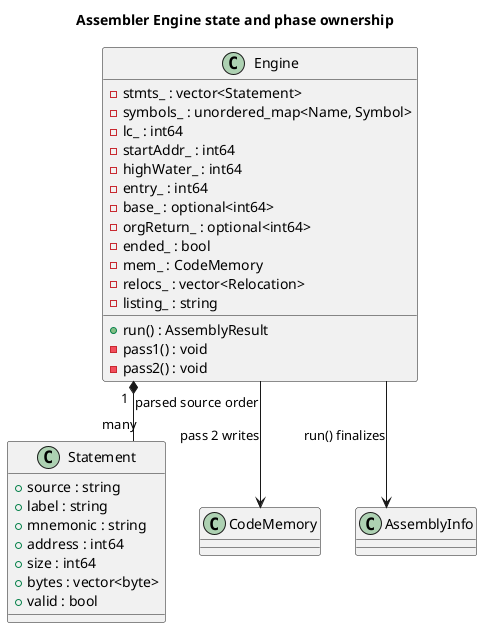
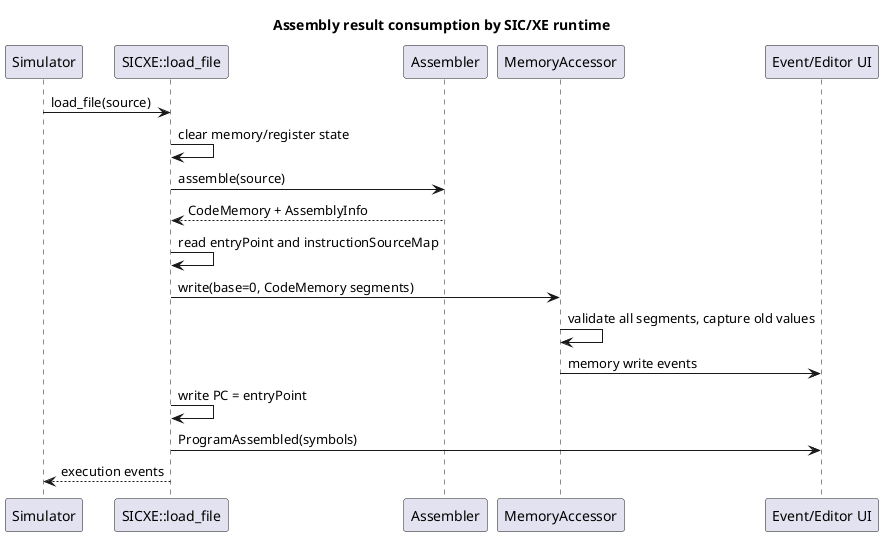

# SIC/XE Assembler: Inner Workings

## Scope

This guide explains the assembler implementation in `lib/sic-xe/src/Assembler/` and its public types in `lib/sic-xe/include/assembler/`. It focuses on source-line parsing, ISA metadata, pass state, layout, instruction/data emission, sparse memory, result metadata, and runtime/editor integration.

**Expression parser/evaluator internals are intentionally excluded.** The assembler invokes `parseExpression` and `evaluate`; here those are treated as an opaque expression service that returns either a diagnosed failure or a value containing an integer and relocation classification. The expression grammar, AST, precedence, and relocation algebra are outside this breakdown.

All source references are relative to the backend directory and refer to the checked-in implementation.

## 1. Public entry points and result contract

There are two public assembly paths in `lib/sic-xe/include/assembler/assembler.hpp:16–114`:

- `assembleDetailed(std::string_view)\ const` returns `AssemblyResult` and does not throw for assembly diagnostics.
- `assemble(std::string)` is the compatibility interface. It stores the latest `AssemblyInfo` in `lastInfo()`, throws `AssemblyError` if the detailed result contains errors, and otherwise returns `CodeMemory`.

`AssemblerOptions` chooses SIC/XE or SIC mode and optionally overrides the memory limit. A zero limit selects 1 MiB for SIC/XE or 32 KiB for SIC. The output separates initialized bytes from metadata:

| Result member | Purpose |
|---|---|
| `AssemblyResult::memory` | Sparse map of initialized object bytes |
| `AssemblyInfo::diagnostics` | Line/column errors and warnings, sorted by source line |
| `programName`, `startAddress`, `length`, `entryPoint` | Program/load metadata |
| `relocations` | Address and half-byte length of relocation fields |
| `symbols` | Name to numeric value map |
| `symbolDefinitions`, `symbolReferences` | Source-position records for editor services |
| `instructionSourceMap` | Emitted instruction address/size to source line mapping |
| `listing` | Address, emitted bytes and original source per statement |

A key contract: `AssemblyResult::ok()` scans diagnostics for an error. Warnings do not make the result fail. The detailed API can return a partial image and metadata alongside diagnostics; the throwing API deliberately converts an error-bearing result to `AssemblyError`.

## 2. Data model and ownership

### 2.1 One Engine per assembly

`Assembler::assembleDetailed` constructs a fresh `Engine` and immediately calls `run()` (`assembler.cpp:45–100, 494–496`). The Engine owns all mutable state for that assembly: parsed statements, diagnostics, symbol table, location counter, base value, ORG return point, sparse output memory, relocation records, listing and status flags. This prevents symbols or locations from leaking between detailed assembly calls.

The persistent `Assembler` object owns only its options and the `last_` metadata cache used by the throwing interface. Sharing an Assembler instance concurrently while calling `assemble()` and reading `lastInfo()` is not equivalent to the side-effect-free detailed API.

```text
AssemblerOptions + source
        |
        v
  fresh Engine
   |       |
   |       +-- per-run state (symbols, LC, diagnostics, base, output)
   |
   +-- parse each physical source line -> vector<Statement>
        |
        +-- pass1(): addresses, sizes, labels, directive effects
        +-- pass2(): bytes, relocations, listing
        |
        v
  AssemblyResult { CodeMemory, AssemblyInfo }
```

### 2.2 Statement as the phase boundary

`Statement` in `assembler/parser.hpp:16–53` combines source-origin data, parsed operands and fields filled in by passes. The parser records line/source text, label and mnemonic positions, whether `+` was used, instruction/directive identity, addressing modes, registers, expression handles and BYTE/WORD items. The passes fill `address`, `size`, `bytes`, and validity.

That structure is the handoff between syntax and assembly semantics: a Statement describes *what the line says* and later *where/how it was assembled*. It does not itself encode machine bytes during parsing.

### 2.3 ISA catalog

`InstructionDef` carries mnemonic, opcode byte, base format (1, 2, or 3), operand schema and whether the instruction exists in SIC (`assembler/isa.hpp:13–37`). Format 3 memory instructions may be promoted to format 4 if `allowsExtended()` is true. Operand schemas drive both parsing and pass-2 emission:

| Schema | Operand data | Emission shape |
|---|---|---|
| None | no operands | opcode, or format-3 no-operand bytes |
| Memory | expression, addressing mode, optional X index | SIC, XE format 3 or XE format 4 |
| Reg | one register number | opcode + register nibble |
| RegReg | two register numbers | opcode + packed register nibbles |
| RegCount | register plus count expression | register nibble + count minus one |
| Number | one service-number expression | number in upper nibble |

The table in `assembler/isa.cpp:10–47` is the assembler’s encoding catalog. It is not the CPU instruction-execution table.

## 3. Line scanning and statement parsing

The engine constructor scans the source for newline boundaries and calls `parseLine` for each physical line (`assembler.cpp:48–60`). This is line-oriented parsing; there is no general token stream produced and passed through all compiler stages.

### 3.1 Comment removal and field recognition

`parseLine` removes trailing CR/LF, ignores blank lines and full-line comments whose first character is a period. `stripComment` tracks whether it is inside single quotes, and treats semicolon as a comment delimiter only outside quotes (`parser.cpp:31–37, 213–223`). This matters for data literals containing punctuation.

It reads whitespace-delimited fields. If the first field is an instruction or directive (after stripping a possible `+` / address suffix for lookup), it is the operation; otherwise it is interpreted as a label, and the next field is the operation. Labels must be ASCII-style identifiers beginning with alphabetic or underscore and continuing with alphanumeric or underscore. Register names cannot be labels (`parser.cpp:15–19, 225–254`).

```asm
LOOP    LDA VALUE       ; LOOP is the label, LDA is the operation
        +JSUB ROUTINE   ; leading + requests extended format
VALUE   WORD 7          ; WORD is a directive, not an instruction
. comment-only line
```

The parser uppercases mnemonics for lookup and stores the original label spelling for user-facing metadata. Symbols are later keyed by uppercase names, making symbol lookup case-insensitive in the implementation.

### 3.2 Operation suffixes and operand splitting

A leading `+` sets `Statement::extended`. A comma suffix on the operation accepts only `,p` and `,b`, corresponding to forced PC-relative or base-relative mode. The parser validates that this mode is only applied to memory instructions and rejects using it with format 4 (`parser.cpp:256–301`, `assembler.cpp:171–198`).

Operands are split on commas outside single-quoted literals; whitespace around each field is trimmed, and the parser retains each operand’s source column (`parser.cpp:40–58`). For memory operands, `#` selects immediate, `@` indirect, and no prefix means simple. A second operand is parsed as a register, but only `$X` is allowed as an index and indexing cannot combine with immediate or indirect addressing (`parser.cpp:111–133`).

```asm
        LDA #5           ; immediate constant
        LDA @PTR         ; indirect target
        LDA VALUE,$X     ; simple indexed addressing
        LDA,p VALUE      ; forced PC relative
        LDA,b VALUE      ; forced base relative
```

Register operands use a dollar prefix, such as `CLEAR $A` or `ADDR $A,$X`. For a small group of arithmetic mnemonics, a register first operand selects the corresponding register-form alias (for example ADD to ADDR). The parser validates operand arity and register names against the instruction schema (`parser.cpp:72–103, 156–174`).

### 3.3 BYTE/WORD literal parsing

The parser converts C and X literals into byte vectors while building data items. A C literal emits one byte per source character. An X literal requires an even count of hexadecimal digits and converts each pair into one byte. WORD does not accept character/hex literals; its items are expression values (`parser.cpp:135–153, 191–205`). This conversion is part of parsing; actual placement into output memory occurs in pass 2.

## 4. The Engine’s state machine

The most important mutable fields in `Engine` are:

| State | Meaning |
|---|---|
| `lc_` | Current location counter for pass-1 layout |
| `startAddr_`, `highWater_` | Program start and highest reached address |
| `entry_`, `entrySet_` | Entry value, defaulted to start if END has no valid selection |
| `symbols_` | Uppercase name to symbol/value/source definition |
| `base_` | Active BASE value during pass 2; cleared by NOBASE |
| `orgReturn_` | One saved location for an operand-free ORG restore |
| `ended_`, `sawEnd_` | Stop processing after END and note whether END occurred |
| `mem_`, `relocs_`, `listing_` | Output bytes and result metadata |

The implementation uses an unordered map for Engine symbol lookup (`assembler.cpp:477–489`). The public result copies symbol values into an ordered map and emits definition/reference vectors sorted by line and column.



A pass-1 invariant is that, after each active statement, `lc_` equals the next unassigned location after that statement’s layout effect (including ORG’s explicit change). `highWater_` tracks the maximum reached location, not necessarily the current location after ORG moves backward. This distinction is used to calculate program length.

## 5. Pass 1: labels, layout, and directives

### 5.1 Traversal and sizing

`Engine::pass1` walks Statements in source order (`assembler.cpp:144–169`). Before each active statement it stores current `lc_` into `st.address`. It dispatches directives and instructions, updates the high-water mark and checks the selected address-space limit.

Instructions define labels at their start address and then receive a size. In SIC/XE, size is 1 for format 1, 2 for format 2, 3 for format 3, and 4 for explicitly extended format 4. In SIC mode, instructions are assigned 3 bytes; unsupported instruction/mode combinations are diagnosed. A format-4 prefix is rejected unless the ISA entry is a format-3 memory instruction that allows extension. The source must request `+`; the assembler does not automatically promote a format-3 instruction when the target is out of range.

```text
for each statement, unless already after END:
    statement.address = lc
    if directive: apply its pass-1 layout operation
    else if instruction:
        define label at lc
        validate mode and choose fixed size
    else:
        define label at lc (label-only or invalid line behavior)
    lc = lc + statement.size
    highWater = max(highWater, lc)
    report the first address-space overflow
```

The size-first rule is the foundation of two-pass assembly. Pass 2 can encode target addresses because labels have already been assigned. A size mistake in pass 1 would shift all later labels and corrupt every address-dependent encoding.

### 5.2 Directive effects

| Directive | Pass-1 effect | Pass-2 effect |
|---|---|---|
| START | Must precede code; sets start, current and high-water address; records program name | No bytes |
| END | Marks assembly ended; optional operand is handled later as entry | Evaluates optional entry expression |
| BYTE | Reserves literal byte count or one byte per expression item | Emits literal bytes or low 8 bits after range check |
| WORD | Reserves three bytes per item | Emits 24-bit values; adds relocation record for relocatable values |
| RESB | Evaluates absolute count; reserves count bytes | No emitted bytes |
| RESW | Evaluates absolute count; reserves count × 3 bytes | No emitted bytes |
| BASE | Defines any label at current address | Evaluates value and sets active base |
| NOBASE | Defines any label at current address | Clears active base |
| EQU | Defines its label as evaluated value; requires a label | No bytes |
| ORG | Changes LC to operand, or restores the single saved LC when operand absent | No bytes |

Directive behavior is implemented across `pass1Directive` and `pass2Directive` (`assembler.cpp:200–256, 294–339`). A label on most location-affecting directives is defined at the location associated with that directive; EQU instead uses its expression value. START sets the label to the start location. END labels current location before the stop affects following lines.

END stops pass-1 layout for later statements; one warning is issued and later statements are marked invalid/ignored. Missing END produces a warning after both passes. If END is absent, or no valid END operand set an entry, the entry defaults to START address (or zero if START was not present).

ORG uses `orgReturn_`, a single optional saved LC. The first ORG with an operand saves the current LC if no return is pending, then changes LC. ORG without operand restores and clears that saved value. This is not a stack; nested ORG regions cannot each preserve independent return points.

### 5.3 Forward references and phase constraints

Pass 1 establishes instruction and data labels before pass 2 evaluates their use sites. Therefore the pass-2 memory operands and WORD values can refer to labels defined later in source. Not every expression-bearing directive is deferred: EQU is evaluated during pass 1 with forward references disallowed at that call site. START, RESB and RESW also need pass-1-known values because they determine layout.

Here “forward reference support” means a symbol used in a pass-2 expression can resolve against the completed pass-1 symbol map. It does not mean every directive can safely contain an unresolved label.

## 6. Pass 2: emission and stateful address selection

### 6.1 Validity gate and output overlap

`Engine::pass2` visits statements in source order; a valid directive/instruction is emitted and then every line contributes to the listing (`assembler.cpp:258–267`). `emit` checks each address against `CodeMemory::contains` before writing. If ORG caused a second initialized byte to overlap a prior byte, it reports an error and marks that statement invalid. A successful emit stores the emitted byte vector back on the Statement for listing and source-map generation (`assembler.cpp:269–280`).

Reservations do not emit placeholders, so a reserved region remains absent from sparse `CodeMemory`; it is not silently initialized to zero by the assembler.

### 6.2 Data directive emission

BYTE literals were converted during parse. BYTE expressions are evaluated during pass 2 and must fit from -128 through 255; the emitted byte is the low eight bits. WORD expressions must fit the accepted signed/unsigned 24-bit interval, are masked to 24 bits, and are emitted most-significant byte first. If a WORD value is relocatable, a six-half-byte relocation record is added at that word’s start address (`assembler.cpp:294–324`).

BASE and NOBASE are pass-2 state changes: BASE evaluates its operand and stores only its numeric value in `base_`; NOBASE resets that optional value. The machine instruction encoder consults this state as it processes subsequent statements. START, RESB, RESW, EQU and ORG emit no bytes in pass 2 (`assembler.cpp:326–338`).

### 6.3 Register and no-operand formats

Pass 2 switches on `OperandSchema` (`assembler.cpp:341–367`):

- Format 1 with no operands emits the opcode byte alone.
- Format 3 with no operands emits three bytes. For XE the opcode has simple-addressing n/i bits set; SIC mode keeps the base opcode and emits two zero address bytes.
- A one-register instruction emits opcode and register number in the high nibble.
- A two-register instruction packs register one in the high nibble and register two in the low nibble.
- A register/count form accepts a count from 1 to 16 and stores count minus one in the low nibble.
- A number-form instruction accepts 0 to 15 and stores that number in the high nibble.

The ISA schema and parse-time arity checks make the pass-2 switch predictable: it can encode fields from already-parsed integer register IDs and an expression value rather than reinterpreting source text.

## 7. SIC and SIC/XE memory instruction encoding

### 7.1 SIC mode

In SIC mode, a memory operand is evaluated as an address, must fit in 15 bits, and is emitted as opcode, index bit plus the high address bits, and low address byte (`assembler.cpp:369–379`). Indexing uses only the X flag. The pass-1 mode checks reject format 4, `,p`/`,b`, and immediate/indirect addressing in SIC mode.

### 7.2 SIC/XE n/i and format 4

For XE memory instructions, the opcode byte ORs the base opcode with n/i bits:

| Address form | n | i |
|---|---:|---:|
| Simple | 1 | 1 |
| Immediate (`#`) | 0 | 1 |
| Indirect (`@`) | 1 | 0 |

The x bit indicates indexed addressing. For explicit format 4, e=1 and b=p=0; the target must fit 20 bits. The emitted second byte contains x, e and the top four address bits; the remaining two bytes contain the rest. Relocatable format-4 operands add a five-half-byte modification record beginning at instruction address + 1 (`assembler.cpp:381–401`).

```text
format 4 (32 bits):
byte 0: opcode[6] | n | i
byte 1: x | b=0 | p=0 | e=1 | address[19:16]
byte 2: address[15:8]
byte 3: address[7:0]
```

The five-half-byte length means the relocation begins at the low nibble of byte 1 and spans the remaining four bytes; the high nibble in that byte holds flags and must not be adjusted.

### 7.3 SIC/XE format 3 selection

A format-3 memory operand is resolved by this ordered policy in `encodeXe` (`assembler.cpp:404–460`):

1. Absolute immediate constants use a direct 12-bit value, range 0–4095. Forced relative mode with such a constant is rejected.
2. For other values, compute `PC displacement = target - (instruction address + 3)`.
3. If the source forces `,p`, require a signed 12-bit displacement (−2048 through 2047) and set p.
4. If the source forces `,b`, require BASE to be active and target minus BASE to be 0–4095; set b.
5. In automatic mode, prefer PC-relative if it fits.
6. Otherwise prefer BASE-relative if BASE is active and the offset fits.
7. Otherwise use a direct address if the absolute target fits 0–4095. If that target is relocatable, emit a warning because the field cannot be relocated.
8. If no field fits, report that format 4 is required.

The final signed PC displacement is masked to 12 bits, which produces the conventional two’s-complement field representation. This is a deterministic preference order, not a linker relaxation algorithm: the assembler does not grow a 3-byte instruction into 4 bytes automatically.

```text
target = 0x0100
instruction address = 0x00F0
PC after instruction = 0x00F3
PC displacement = 0x0100 - 0x00F3 = +13
=> p=1, b=0, 12-bit field=0x00D
```

This is an arithmetic illustration of the selection formula. Whether PC-relative is selected depends on the actual statement and active BASE state; in this case automatic mode selects PC-relative because +13 fits.

## 8. Sparse memory and result finalization

### 8.1 CodeMemory segment invariant

`CodeMemory` stores a sorted map from segment start address to byte vector (`include/memory/CodeMemory.hpp:1–82`). Writes extend an adjacent previous/next segment, merge segments when bridging a one-byte gap, overwrite an existing byte if directly written there, or create a new segment. Its invariant is that segments do not overlap or remain adjacent. The assembler’s own `emit` overlap check adds the semantic constraint that one assembly statement cannot silently replace previously emitted output.

This representation scales with emitted bytes and segment count rather than with the full one-megabyte address space. A program with separate initialized regions costs storage for those regions and their map entries; RES directives do not allocate all reserved bytes in the image.

### 8.2 Metadata collection

After pass 2, `Engine::run` moves memory and diagnostics into the result, sets program metadata, copies symbol values, and visits parsed statements to collect expression symbol references and instruction source entries (`assembler.cpp:63–100`). Definition and reference vectors are stable-sorted by line then column. The symbol name/value map uses original spelling on output even though lookup keys are uppercase.

The instruction source map includes only valid emitted instructions with nonempty bytes, and stores start address, encoded size and 1-based source line. It later allows the architecture/debugger to associate fetched instruction addresses with source lines.

## 9. Runtime and language-service integration

### 9.1 Simulator load path

For assembly source, `SICXE::load_file` clears program state, calls the throwing assembler interface, and clears assembler metadata if assembly throws. On success it reads entry point and instruction source mappings from `lastInfo()`, writes the sparse image into memory at base zero, sets PC to the entry point, and emits the symbol table to the UI (`lib/sic-xe/src/SICXE.cpp:132–189`). `MemoryAccessor::write(CodeMemory)` validates and captures every segment before committing writes, preventing an out-of-bounds segment from causing a partially loaded image (`src/memory/MemoryAccessor.cpp:29–66`).

The current loader does not show a relocation application step. Assembly addresses are already absolute in this path. Relocation records are available to another consumer, but moving the image requires additional loader/linker behavior that is not present here.



### 9.2 Language service

The language service runs `Assembler().assembleDetailed(document.text)` when it needs document analysis, caches that result for the unchanged document, and serves diagnostics/symbol requests from its `AssemblyInfo`. This means parser/assembler semantics are reused by editor features; the LSP has no separate code generator. It is a full-document reassembly after invalidation, not incremental assembly.

## 10. Important invariants, limitations, and extension points

### Invariants enforced by code

- Every emitted instruction has a pass-1 address and size before pass 2.
- Every symbol lookup is case-normalized, while output can preserve its display spelling.
- A successful `emit` cannot overlap already-emitted bytes.
- The assembler’s sparse image holds initialized bytes only; reservations advance layout without emitting initialized values.
- The entry point defaults to START when END does not supply a resolved operand.
- SIC/XE format-3 displacement selection is PC-relative, then BASE-relative, then direct.

### Boundaries that a consumer must understand

1. **Assembler support is not CPU support.** The assembler’s ISA catalog and runtime dispatch are separate implementations.
2. **Relocations are metadata only in the inspected simulator path.** No object-module writer or relocation applier is used by `SICXE::load_file`.
3. **Instruction size is not auto-relaxed.** A too-distant format-3 target is diagnosed with a suggestion to use `+`; following addresses are not silently shifted.
4. **ORG saves only one restore point.** Nested regions are not independently stacked.
5. **Detailed assembly can carry partial output with errors.** Callers must check `ok()`; the runtime’s throwing API does this conversion for its caller.
6. **Runtime fetch uses a four-byte window.** SICXE declares address width 4 and fetches that many bytes before decode. A short instruction placed at the very end of memory may be encodable but fail fetch bounds.
7. **Expression behavior is intentionally not explained here.** Only expression call boundaries and their layout/encoding effects are discussed; see the expression module and grammar docs for that separate concern.

### Failure path at a glance

```text
parseLine error
  -> Diagnostic + Statement.valid=false
  -> passes preserve enough state to continue gathering errors
  -> pass2 skips invalid statements but still appends listing rows
  -> AssemblyResult contains diagnostics/possibly partial memory
  -> detailed caller checks ok()
  -> throwing caller receives AssemblyError instead of CodeMemory
```

This behavior is why diagnostics are part of the public result rather than only exception strings. It lets the editor continue to display line-specific problems while the runtime can reject an error-bearing assembly.

## 11. PlantUML diagrams

The standalone diagrams are in `docs/uml/`:

- [High-level assembler flow](../uml/36_assembler_high_level_flow.puml)
- [Syntax and format resolution](../uml/37_syntax_and_format_resolution.puml)
- [Parser flow](../uml/38_parser_stage_flow.puml)
- [Pass-1 layout flow](../uml/39_pass1_stage_flow.puml)
- [Pass-2 evaluation and emission flow](../uml/40_pass2_stage_flow.puml)
- [Instruction encoding flow](../uml/41_instruction_encoding_flow.puml)
- [Assembler component/data-flow map](../uml/24_assembler_pipeline.puml)
- [Parse and two-pass activity](../uml/25_assembler_passes.puml)
- [Pass-1 layout and directive state](../uml/26_assembler_pass1.puml)
- [Pass-2 emission and encoding branches](../uml/27_assembler_pass2.puml)
- [Format-3/4 selection sequence](../uml/28_assembler_encoding_sequence.puml)
- [Runtime result consumption](../uml/29_assembler_runtime_sequence.puml)

The expression service is shown only as a black-box collaborator in diagrams; none attempts to describe expression parsing or evaluation internals.

## Source map

| Topic | Implementation |
|---|---|
| Public result/API | `lib/sic-xe/include/assembler/assembler.hpp:16–114` |
| Statement and operand model | `lib/sic-xe/include/assembler/parser.hpp:16–53` |
| Parser and literal handling | `lib/sic-xe/src/Assembler/parser.cpp:31–309` |
| ISA catalog | `lib/sic-xe/include/assembler/isa.hpp:13–37`, `src/Assembler/isa.cpp:10–88` |
| Engine and result finalization | `lib/sic-xe/src/Assembler/assembler.cpp:45–115, 477–508` |
| Pass 1 | `lib/sic-xe/src/Assembler/assembler.cpp:144–256` |
| Pass 2 and data emission | `lib/sic-xe/src/Assembler/assembler.cpp:258–367` |
| SIC/XE addressing | `lib/sic-xe/src/Assembler/assembler.cpp:369–461` |
| Sparse memory | `include/memory/CodeMemory.hpp:1–82` |
| Simulator assembly load | `lib/sic-xe/src/SICXE.cpp:132–189` |
| Atomic segment validation/write | `src/memory/MemoryAccessor.cpp:29–66` |
| Language-service analysis call | `src/language/LanguageServer.cpp:245–273` |
