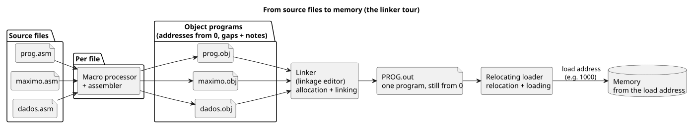

# 1. Why linkers exist

## One file is not enough

Picture a program written as a single assembly file. It works, but:

- every change, however small, means assembling the whole program again;
- two people cannot work on it without editing the same file;
- a routine that many programs need, such as "read a record" or "print a number", has to be
  copied into each of them.

The fix is to split the program into files and assemble each one separately. That creates
two problems the assembler cannot solve while it looks at one file.

**Problem 1: the assembler does not know where the file will be in memory.** Labels get
addresses counted from the start of the file. `N WORD 5` at offset `1A` is "address `1A`".
If the file ends up at `1000`, every instruction that uses `N` as an address must say `101A`
instead.

**Problem 2: the assembler does not know the addresses of names defined in other files.**
`prog.asm` calls `MAXIMO`, which lives in `maximo.asm`. While assembling `prog.asm`, the
address of `MAXIMO` is simply unknown.

The assembler's answer to both is the same: write what it knows, leave a gap where it does
not, and attach a note saying how to fill the gap. A later program reads the notes and fills
the gaps. That later program is the **linker** (and, for the last step, the **loader**).

## The four jobs

Beck's chapter 3 splits the work after assembly into four jobs:

| Job | Question it answers | In the tour |
|---|---|---|
| **Allocation** | Where does each piece go? | `PROG` at 0, `DADOS` right after it, then `TABELA`, then `MAXIMO` |
| **Linking** (symbol resolution) | What address does each external name have? | `MAXIMO` is at `2F` in the joined program |
| **Relocation** | Which addresses change because a piece moved, and by how much? | the field of `+LDA N` changes from `1A` to `101A` when loaded at `1000` |
| **Loading** | Copy the bytes into memory and set the program counter | memory from `1000` to `1044`, `PC = 1000` |

Different systems split these jobs between programs in different ways. Chapter 7 compares
the options. This simulator uses:

- the **assembler**, which writes one **object program** per file, with notes for every gap;
- the **linker** (a *linkage editor*, Beck §3.4.1), which does allocation and linking and
  writes one joined program that still starts at address 0;
- the **relocating loader** (Beck §3.2.1), which adds the chosen load address and fills
  memory.



[diagrams/01-big-picture.puml](diagrams/01-big-picture.puml)

## You have used one already

If you have compiled C with more than one file, you have used a linker:

```text
gcc -c main.c       ->  main.o     (an object file with gaps and notes)
gcc -c util.c       ->  util.o
gcc main.o util.o   ->  a.out      (the linker, ld, joins them)
./a.out                            (the operating system's loader loads it)
```

`extern int count;` in C is an external reference, like `EXTREF` in SIC/XE. A non-`static`
global is an external definition, like `EXTDEF`. "undefined reference to `foo`" is the same
error this simulator reports as `undefined external symbol FOO`. The ideas in this guide carry
over to ELF and PE files; only the record formats are bigger.

## What to remember

- The assembler sees one file. It cannot know where that file will be loaded or where other
  files' names are.
- It leaves gaps plus notes. The linker and the loader fill the gaps.
- The four jobs are allocation, linking, relocation and loading.

Next: [2. SIC/XE essentials](02-sicxe-essentials.md).
