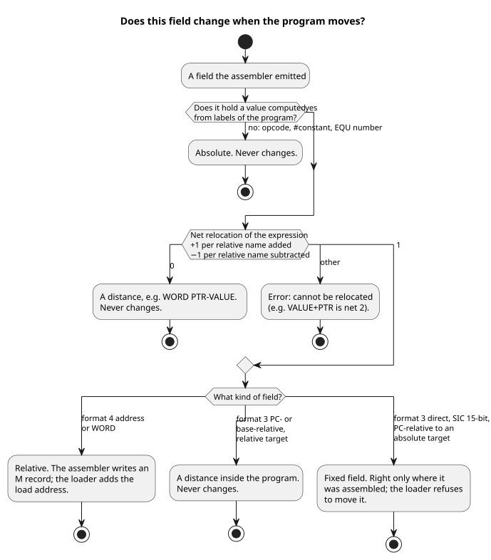

# 3. Relocation

**Relocation** is changing the fields of a program so that it works at an address other than
the one it was assembled for. This chapter uses one file, so there is nothing to link yet:
only the question of what changes when a program moves.

## The example

`rel.asm`, assembled from 0 and then loaded at `1000`:

```text
REL     START 0
       +LDA VALUE          ; format 4: holds the address of VALUE
        LDA VALUE          ; format 3, PC-relative: holds a distance
        RSUB
VALUE   WORD 5             ; a number
PTR     WORD VALUE         ; the address of VALUE
DIST    WORD PTR-VALUE     ; a distance between two addresses
        END REL
```

| Offset | Statement | Bytes assembled from 0 | Bytes in memory at `1000` | Changed? |
|---|---|---|---|---|
| `00` | `+LDA VALUE` | `03 10 00 0A` | `03 10 10 0A` | yes |
| `04` | `LDA VALUE` | `03 20 03` | `03 20 03` | no |
| `07` | `RSUB` | `4F 00 00` | `4F 00 00` | no |
| `0A` | `WORD 5` | `00 00 05` | `00 00 05` | no |
| `0D` | `WORD VALUE` | `00 00 0A` | `00 10 0A` | yes |
| `10` | `WORD PTR-VALUE` | `00 00 03` | `00 00 03` | no |

(These bytes come from the simulator: `load @1000 %rel.asm`.)

Two fields changed, and both hold **the address of something inside the program**. Every
other field holds a distance, a number or an opcode, and those do not depend on where the
program is.

- `+LDA VALUE` holds the address of `VALUE`. At `1000`, `VALUE` is at `100A`.
- `LDA VALUE` holds `VALUE - PC`. Both `VALUE` and `PC` moved by `1000`, so the distance is
  the same.
- `WORD PTR-VALUE` is a distance. `PTR` and `VALUE` both move, and the difference stays 3.

## Relative and absolute values

Every value the assembler computes is one of two kinds:

- **absolute**: a number that means the same thing wherever the program is (`5`, a length,
  a distance);
- **relative** (relocatable): an address inside the program, which changes when the program
  moves.

A label is relative. A constant is absolute. Expressions combine them like this:

| Expression | Kind | Why |
|---|---|---|
| `VALUE` | relative | an address |
| `VALUE + 3` | relative | an address 3 bytes further |
| `PTR - VALUE` | absolute | both move by the same amount; it cancels |
| `VALUE + PTR` | neither: an error | moving by `d` adds `2d`, which no fix can express |
| `5 * VALUE` | neither: an error | same reason |

A useful way to check: count each relative name +1 when it is added and −1 when it is
subtracted. That sum is the **relocation degree** of the expression (chapter 6 calls it the
**net relocation**). 0 means absolute, 1 means relative, anything else cannot be relocated.

## The modification record

The assembler cannot fix the fields itself, because it does not know the load address. It
writes a note for each field that holds a relative value: a **modification record**, or
**M record**.

```text
M 000001 05 +REL       the 5 half-bytes starting at 000001: add the address of REL
M 00000D 06 +REL       the 6 half-bytes starting at 00000D: add the address of REL
```

- The first number is where the field starts, counted from the start of the program.
- The second is the field's length in **half-bytes** (hex digits): 5 for a format-4 address
  (20 bits), 6 for a `WORD` (24 bits).
- When the length is odd, the field starts in the low half of the first byte. That is why the
  record for `+LDA VALUE` (which starts at `00`) says `000001 05`: the address is the last
  half of byte `01` plus bytes `02` and `03`.
- `+REL` says what to add: the address of the section `REL`, which is where the program was
  loaded.

At load address `1000`, the loader adds `1000` to each of those two fields. That is
relocation. Chapter 5 shows the other records of the object program.

## Fields that cannot be fixed

Some fields hold an address but are too narrow, or are built in a way that no M record can
repair. This project calls them **fixed fields**.

- **Format-3 direct address of a label.** The field is 12 bits, so it can hold at most `FFF`.
  At `1000` the address would not fit. The assembler warns: `Direct addressing of a
  relocatable operand cannot be relocated; consider +LDA`.
- **A SIC instruction** (`n = i = 0`) with a 15-bit address, for the same reason.
- **PC-relative to an absolute target.** `LDA LIMIT` where `LIMIT EQU 100`: the target stays
  at 100 but `PC` moves, so the distance changes.
- **Base-relative where the base and the target are of different kinds** (one relative, one
  absolute), for the same reason.

A fixed field is correct only where it was assembled. The simulator runs such a program at
load address 0, and refuses to move it (chapter 7).



[diagrams/03-does-this-field-move.puml](diagrams/03-does-this-field-move.puml)

## What to remember

- A field must change when it holds an address inside the program.
- Distances, numbers and opcodes do not change.
- The assembler marks each field to change with an M record: where, how wide, what to add.
- Count +1 / −1 per relative name: 0 is absolute, 1 is relative, anything else is an error.

Next: [4. Control sections and external symbols](04-control-sections.md).
