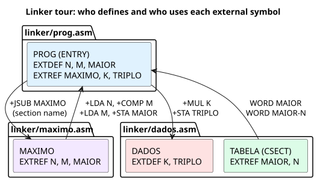

# 4. Control sections and external symbols

Chapter 3 moved one program as a whole. Now the program is in pieces, and the pieces refer
to each other.

## Control sections

A **control section** is a part of a program that the assembler handles on its own: its own
location counter starting at 0, its own labels, its own object program. The linker can place
each control section anywhere. In SIC/XE (Beck §2.3.5):

- `START` opens the first control section of a file;
- `CSECT` opens another one in the same file;
- a file can hold any number of sections; `END` closes the file.

Labels of one section are invisible to the others, even in the same file. Using one is an
error that tells you what to do: `VAL is defined in section SECA; add it to EXTREF`.

## External symbols

Two directives connect sections:

- `EXTDEF names` (**external definition**): these labels of this section may be used by
  other sections.
- `EXTREF names` (**external reference**): these names are defined in some other section;
  this section uses them.

A section's own name is also an external symbol, without `EXTDEF`. So `+JSUB MAXIMO` works
when `MAXIMO` is the name of a section, as it is in the tour.

The assembler does not know an external symbol's address, so it writes 0 in the field and an
M record naming the symbol: `M 00000A 05 +MAXIMO`. Only two kinds of field can take an
external symbol:

- a **format-4 address** (5 half-bytes). In format 3 the assembler stops with
  `MAXIMO is an external reference; use +JSUB MAXIMO (format 4)`, because a 12-bit field
  cannot hold an address that might be anywhere in memory;
- a **`WORD`** (6 half-bytes): `WORD MAIOR`, or `WORD MAIOR-N` with two externals.

## Two directives this project adds

Beck's examples link a fixed list of programs and start at the first one. In the simulator,
students choose which files of a project to link, so two rules are needed:

- **`ENTRY`** works exactly like `START` and also marks the file the program starts in.
  Exactly one of the linked files must have it. That file goes first in memory. Without it:
  `no ENTRY in the linked files`; with two: `a second ENTRY (the first is in linker/prog.asm)`.
- **`END label`** may name the first instruction only in the `ENTRY` file. A subroutine file
  ends with a plain `END`. Otherwise: `only the ENTRY file can name a transfer address`.

When files are linked, every `START`/`ENTRY` must be 0: `START must be 0 when files are
linked`. A program assembled for a fixed address cannot be moved anyway (chapter 7).

## The tour, file by file

`linker/prog.asm` (comments trimmed; line numbers are the file's own):

```text
28  PROG    ENTRY 0
29          EXTDEF N,M,MAIOR      ; usable by the other files
30          EXTREF MAXIMO,K,TRIPLO ; defined in the other files
    ...     (the macro DOBRA, lines 33-38)
40  INICIO  DOBRA N               ; N = N + N = 10
43         +JSUB MAXIMO           ; MAIOR = max(N, M) = 10
44         +LDA N
45         +MUL K                 ; K = 3, in dados.asm
46         +STA TRIPLO            ; TRIPLO = N * K = 30, in dados.asm
47          HALT
48  N       WORD 5
49  M       WORD 7
50  MAIOR   RESW 1
51          END INICIO
```

`linker/maximo.asm`:

```text
 9  MAXIMO  START 0
10          EXTREF N,M,MAIOR
11         +LDA N
12         +COMP M
13          JGT FIM               ; local, PC-relative: never relocated
14         +LDA M
15  FIM    +STA MAIOR
16          RSUB
17          END
```

`linker/dados.asm`, two control sections in one file:

```text
 6  DADOS   START 0
 7          EXTDEF K,TRIPLO
 8  K       WORD 3
 9  TRIPLO  RESW 1
14  TABELA  CSECT
15          EXTREF MAIOR,N
16  ENDMAIOR WORD MAIOR            ; the loaded address of MAIOR
17  DISTANC WORD MAIOR-N           ; 6, wherever the program is loaded
18          END
```

Things to notice:

- `+LDA N` appears in both `prog.asm` and `maximo.asm`. In `prog.asm`, `N` is local, so the
  field gets `1A` and an M record `+PROG` (local relocation). In `maximo.asm`, `N` is
  external, so the field gets 0 and an M record `+N`.
- `TABELA` cannot see `K`, although `K` is in the same file: `K` belongs to the section
  `DADOS`. To use it, `TABELA` would need `EXTREF K`, just as if `K` were in another file.
- `DISTANC WORD MAIOR-N` has two M records, `+MAIOR` and `-N`. Both names are in `PROG`, so
  the difference is a distance (net 0). The linker works that out in chapter 6.



[diagrams/04-tour-symbols.puml](diagrams/04-tour-symbols.puml)

## What to remember

- A control section has its own location counter from 0 and its own labels.
- `EXTDEF` exports, `EXTREF` imports; a section name is exported automatically.
- An external symbol fits only a format-4 address or a `WORD`.
- `ENTRY` marks the one file the program starts in; only that file's `END` names an address.

Next: [5. The object program](05-object-program.md).
