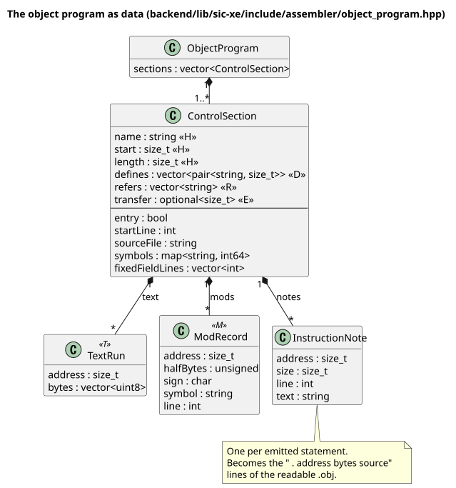

# 5. The object program

The **object program** is what the assembler hands to the linker: the bytes of one file plus
every note the linker needs. SIC/XE writes it as text, one **record** per line, and each
record starts with a letter that says what it is.

## The six records

Beck's formats (§2.3.5, Fig. 2.17 and 3.9) are fixed columns:

| Record | Columns | Fields |
|---|---|---|
| `H` header | 2-7, 8-13, 14-19 | section name, start address, length |
| `D` define | 2-7, 8-13, repeated | an `EXTDEF` name and its address in the section |
| `R` refer | 2-7, repeated | an `EXTREF` name |
| `T` text | 2-7, 8-9, 10-69 | start address, length in bytes (at most 30), the bytes |
| `M` modification | 2-7, 8-9, 10, 11-16 | field address, field length in half-bytes, `+` or `-`, symbol |
| `E` end | 2-7 | address of the first instruction (only in the section that has one) |

There is one `H … E` group per control section. All addresses are relative to the start of
the section.

The `M` record here is Beck's **revised** form (§2.3.5): it names a symbol to add or
subtract. The first form, in §2.2.2, only said "relocate this field" and always added the
program's start. The revised form handles both external references (`+MAXIMO`) and local
relocation (`+PROG`, the section's own name, as in Fig. 3.9) with one rule.

## The readable `.obj`

The simulator prints the same records with spaces between fields instead of fixed columns,
and adds two things to help a person read them:

- after each `T` record, one line per instruction starting with a dot, `  .  address  bytes
  source`, showing which statement produced which bytes;
- after each `M` record, a comment `. statement (file:line)`. The line is in the file's
  assembly text, which is `MASMAPRG.ASM` when the file uses macros.

A `T` record never splits an instruction, so the dotted lines always match whole groups of
bytes.

The `.obj` text is generated from the `ObjectProgram` data structure (below) and never parsed
back. The linker works on the structure, not on the text.

## `prog.obj`, record by record

```text
H PROG   000000 000023
D N      00001A M      00001D MAIOR  000020
R MAXIMO K TRIPLO
T 000000 1D 032017 1B2014 0F2011 4B100000 0310001A 23100000 0F100000 FC 000005
  .  000000  032017      LDA N
  .  000003  1B2014      ADD N
  .  000006  0F2011      STA N
  .  000009  4B100000    +JSUB MAXIMO
  .  00000D  0310001A    +LDA N
  .  000011  23100000    +MUL K
  .  000015  0F100000    +STA TRIPLO
  .  000019  FC          HALT
  .  00001A  000005      WORD 5
T 00001D 03 000007
  .  00001D  000007      WORD 7
M 00000A 05 +MAXIMO         . +JSUB MAXIMO (linker/prog.asm:40)
M 00000E 05 +PROG           . +LDA N (linker/prog.asm:41)
M 000012 05 +K              . +MUL K (linker/prog.asm:42)
M 000016 05 +TRIPLO         . +STA TRIPLO (linker/prog.asm:43)
E 000000
```

- `H`: the section `PROG` starts at 0 and is `23` (35) bytes long.
- `D`: `PROG` exports `N` at `1A`, `M` at `1D` and `MAIOR` at `20`.
- `R`: it uses `MAXIMO`, `K` and `TRIPLO` from elsewhere.
- First `T`: `1D` (29) bytes from address 0. `LDA N`, `ADD N`, `STA N` are the expansion of
  the macro `DOBRA N`; they are PC-relative, so they need no M record.
- `4B100000`: `JSUB` in format 4 with address 0, because `MAXIMO` is external. The record
  `M 00000A 05 +MAXIMO` says: add the address of `MAXIMO` to the 5 half-bytes at `0A`.
- `0310001A`: `+LDA N` already holds `1A`, the offset of `N` in this section. The record
  `M 00000E 05 +PROG` is local relocation: add the address where `PROG` ends up.
- There is no `T` record for `MAIOR RESW 1`: reserved space has no bytes. That is also why
  the second `T` starts at `1D` and stops at `20`; the section is still `23` long.
- `E 000000`: the program starts at offset 0 of `PROG` (`INICIO`).
- The comment `(linker/prog.asm:40)` points to line 40 of `MASMAPRG.ASM`, because
  `prog.asm` has a macro; the same statement is line 43 of `prog.asm`.

## `dados.obj`: two sections in one file

```text
H DADOS  000000 000006
D K      000000 TRIPLO 000003
T 000000 03 000003
  .  000000  000003      WORD 3
E
H TABELA 000000 000006
R MAIOR N
T 000000 06 000000 000000
  .  000000  000000      WORD MAIOR
  .  000003  000000      WORD MAIOR-N
M 000000 06 +MAIOR          . WORD MAIOR (linker/dados.asm:16)
M 000003 06 +MAIOR          . WORD MAIOR-N (linker/dados.asm:17)
M 000003 06 -N              . WORD MAIOR-N (linker/dados.asm:17)
E
```

Two `H … E` groups, each counting from 0. Neither `E` has an address: only the `ENTRY` file
names the first instruction. `WORD MAIOR-N` produced two M records for the same field, one
`+` and one `-`: the linker applies both in order.

## The data structure



[diagrams/05-object-model.puml](diagrams/05-object-model.puml)

`ControlSection` keeps a few fields that are not records but help the rest of the system:
`notes` (the dotted lines), `symbols` (every label, for the editor's symbol table),
`fixedFieldLines` (lines with a fixed field, chapter 3), `entry`, `startLine` and
`sourceFile` (for error messages and the trace).

## What to remember

- One `H … E` group per control section; addresses relative to the section.
- `D`/`R` list the exports and imports; `T` holds the bytes; `M` says which fields to fix and
  with which symbol.
- The readable `.obj` adds dotted lines and comments; the linker reads the data structure,
  never the text.

Next: [6. The linker](06-the-linker.md).
