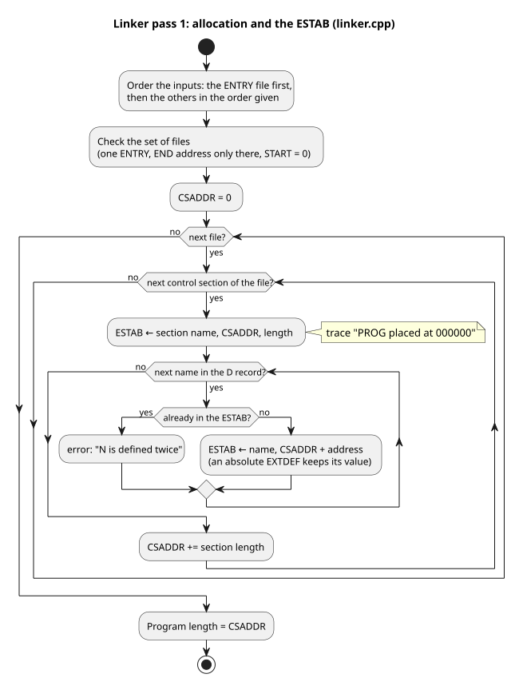
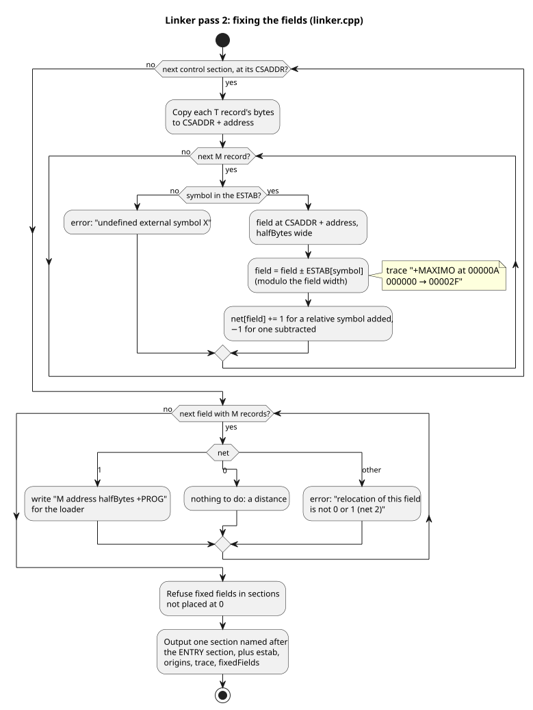

# 6. The linker

The linker receives the object programs of all linked files and produces one program. This
project's linker is a **linkage editor** (Beck §3.4.1): its output is a program that still
starts at address 0, written as an object program like its inputs, and a separate loader
puts it in memory (chapter 7).

Input order: the file with `ENTRY` first, then the others in the order the Run command gave
them. For the tour, `load @1000 %linker/prog.asm %linker/dados.asm %linker/maximo.asm` gives
the sections in the order `PROG`, `DADOS`, `TABELA`, `MAXIMO`.

## Why two passes

To fix `+JSUB MAXIMO` in `PROG`, the linker needs the address of `MAXIMO`. But `MAXIMO` comes
after `PROG`, and its address depends on the lengths of every section before it. So the
linker first walks all sections to decide where everything goes (pass 1), then walks them
again to fix the fields (pass 2). It is the same reason a two-pass assembler has two passes:
forward references.

## Pass 1: allocation and the ESTAB

The **ESTAB** (external symbol table) maps every external symbol to its address in the
linked program. A counter, **CSADDR** (control section address), says where the next section
starts.



[diagrams/06-pass1.puml](diagrams/06-pass1.puml)

For the tour:

| Step | CSADDR | ESTAB gains | Why |
|---|---|---|---|
| `PROG` placed | `000000` | `PROG = 000000`, length `23` | first section |
| `D` of `PROG` | | `N = 00001A`, `M = 00001D`, `MAIOR = 000020` | `0 + 1A`, `0 + 1D`, `0 + 20` |
| `DADOS` placed | `000023` | `DADOS = 000023`, length `6` | `0 + 23` |
| `D` of `DADOS` | | `K = 000023`, `TRIPLO = 000026` | `23 + 0`, `23 + 3` |
| `TABELA` placed | `000029` | `TABELA = 000029`, length `6` | `23 + 6` |
| `MAXIMO` placed | `00002F` | `MAXIMO = 00002F`, length `16` | `29 + 6` |

The program ends at `2F + 16 = 45`, the length in the `H` record of `PROG.out`.

The load address does not appear here. The linker always works from 0; adding the load
address is the loader's job. That is the difference from Beck's **linking loader** (§3.2.3,
Fig. 3.11), which starts CSADDR at the load address and writes straight into memory.

Pass 1 also checks the set of files and reports, with the file and line:

| Problem | Message |
|---|---|
| no file has `ENTRY` (with two or more files) | `no ENTRY in the linked files` |
| two files have `ENTRY` | `a second ENTRY (the first is in linker/prog.asm)` |
| a subroutine's `END` names an address | `only the ENTRY file can name a transfer address` |
| a `START` other than 0 | `START must be 0 when files are linked` |
| a name exported twice | `N is defined twice`, in both files, each at the start line of the section that exports it |

## Pass 2: fixing the fields

Each section's `T` bytes are copied to `CSADDR + address`. Then each `M` record is applied:
look the symbol up in the ESTAB, add or subtract its address to the field, and keep only the
field's width (5 or 6 half-bytes), so the arithmetic wraps like the hardware would.



[diagrams/06-pass2.puml](diagrams/06-pass2.puml)

The trace of pass 2 for the tour (the Ligador tab shows the same list):

| M record | Field at | Before → after | Statement |
|---|---|---|---|
| `+MAXIMO` | `00000A` | `000000 → 00002F` | `+JSUB MAXIMO` in `prog.asm` |
| `+PROG` | `00000E` | `00001A → 00001A` | `+LDA N` (PROG is at 0) |
| `+K` | `000012` | `000000 → 000023` | `+MUL K` |
| `+TRIPLO` | `000016` | `000000 → 000026` | `+STA TRIPLO` |
| `+MAIOR` | `000029` | `000000 → 000020` | `WORD MAIOR` in `TABELA` |
| `+MAIOR` | `00002C` | `000000 → 000020` | `WORD MAIOR-N` |
| `-N` | `00002C` | `000020 → 000006` | `WORD MAIOR-N` |
| `+N` | `000030` | `000000 → 00001A` | `+LDA N` in `maximo.asm` |
| `+M` | `000034` | `000000 → 00001D` | `+COMP M` |
| `+M` | `00003B` | `000000 → 00001D` | `+LDA M` |
| `+MAIOR` | `00003F` | `000000 → 000020` | `+STA MAIOR` |

A symbol that is not in the ESTAB is reported as `undefined external symbol MAXIMO` at the
line that uses it. That happens, for example, when `maximo.asm` is switched off.

## Net relocation: what the loader still has to do

After pass 2 every field holds the right value **for a program at address 0**. Some of those
values are addresses inside the program and must still move with the load address. The
linker finds them by counting, per field, +1 for each relative name added and −1 for each
relative name subtracted (an absolute `EQU` exported with `EXTDEF` counts 0):

| Net | Meaning | What the linker writes in `PROG.out` |
|---|---|---|
| 1 | the field is an address | one record `M address halfbytes +PROG` |
| 0 | a distance or a number | nothing: `WORD MAIOR-N` stays `000006` |
| other | cannot be relocated | error `relocation of this field is not 0 or 1 (net 2)` |

The `+PROG` names the linked program, so the loader only ever sees one kind of M record:
"add the load address here". There are 9 in `PROG.out`.

The linker also refuses a fixed field (chapter 3) in any section it placed away from 0:
`this address field cannot be relocated; use format 4 (+) here`.

## The output

```text
H PROG   000000 000045
T 000000 1D 032017 1B2014 0F2011 4B10002F 0310001A 23100023 0F100026 FC 000005
T 00001D 03 000007
T 000023 03 000003
T 000029 06 000020 000006
T 00002F 16 0310001A 2B10001D 372004 0310001D 0F100020 4F0000
M 00000A 05 +PROG
M 00000E 05 +PROG
M 000012 05 +PROG
M 000016 05 +PROG
M 000029 06 +PROG
M 000030 05 +PROG
M 000034 05 +PROG
M 00003B 05 +PROG
M 00003F 05 +PROG
E 000000
```

(the dotted lines are left out here). One section, named after the entry section. `JGT FIM`
is `372004` in both `maximo.obj` and `PROG.out`: a PC-relative jump inside `MAXIMO` moves
with it. Besides the program, the linker returns:

- `estab`: the table above;
- `origins`: which file and section each byte range came from; the editor colours `PROG.out`
  with them;
- `trace`: one step per ESTAB row in pass 1 and per M record in pass 2;
- `fixedFields`, for the loader.

## What to remember

- Pass 1: CSADDR from 0, place each section, fill the ESTAB.
- Pass 2: copy the bytes, apply every M record with the ESTAB.
- Net relocation per field: 1 becomes `M +PROG`, 0 needs nothing, anything else is an error.
- The output is a program from 0. The load address is not known yet.

Next: [7. The loader](07-the-loader.md).
