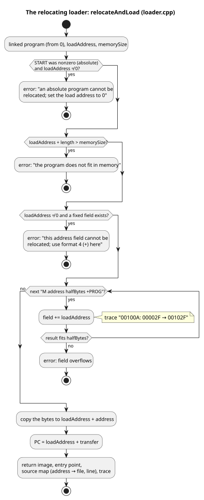
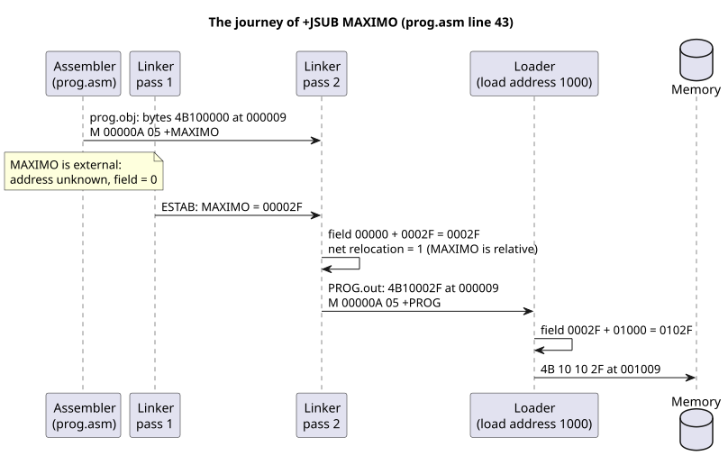

# 7. The loader

The **loader** puts a program in memory and starts it. A **relocating loader** (Beck §3.2.1)
can put it at any address, by adjusting the fields the object program marks.

## Who does what: three designs

Beck chapter 3 describes several ways to divide the four jobs from chapter 1:

| Design | Linking happens | Relocation happens | Book |
|---|---|---|---|
| **Linking loader** | at load time, every time the program runs | at load time | §3.2.3 |
| **Linkage editor** + relocating loader | once, ahead of time, into a linked program | at load time, by the loader | §3.4.1 |
| **Dynamic linking** | when a routine is first called | at that moment | §3.4.2 |

This project uses the second design. The linker's output (`PROG.out`) is a complete program
the student can read before anything is loaded, and the loader stays small: it only adds one
number to the fields the linker marked. Dynamic linking and overlays are not implemented.

Beck also shows two ways to tell a relocating loader which fields to adjust: M records
(§3.2.1, Fig. 3.5) and a **relocation bit mask** per `T` record (Fig. 3.7), which suits SIC
programs where almost every word is an address. This project uses M records, because SIC/XE
programs relocate few fields.

## The algorithm

`relocateAndLoad(linked, loadAddress, memorySize)` in
[loader.cpp](../../backend/lib/sic-xe/src/Assembler/loader.cpp):

[diagrams/07-loader.puml](diagrams/07-loader.puml)

1. **Checks, before writing anything:**
   - a program assembled with a nonzero `START` is **absolute**: it can only go where it
     says. At any other load address: `an absolute program cannot be relocated; set the load
     address to 0`;
   - the whole program, including reserved space, must fit in memory: `the program does not
     fit in memory: it ends at …`;
   - at a nonzero load address, any fixed field is refused: `this address field cannot be
     relocated; use format 4 (+) here`, at its file and line.
2. **Relocate:** for each `M … +PROG`, add the load address to the field. If the result does
   not fit the field's half-bytes, the load fails (`the relocated address field overflows
   its …`).
3. **Load:** copy the bytes to `loadAddress + address`.
4. **Start:** `PC = loadAddress + transfer` (the `E` record), or the load address when there
   is none.

It also returns a **source map**: for each loaded instruction, its file and line. The
debugger uses it to open the right file when a step enters another file.

At load address 0 nothing moves, and the loader's trace is empty.

## One field, from the assembler to memory

[diagrams/07-field-journey.puml](diagrams/07-field-journey.puml)

| Stage | The 4 bytes of `+JSUB MAXIMO` | What happened |
|---|---|---|
| `prog.obj` | `4B 10 00 00` | `MAXIMO` unknown; `M 00000A 05 +MAXIMO` |
| `PROG.out` | `4B 10 00 2F` | linker: `MAXIMO` is at `2F`; net 1, so `M 00000A 05 +PROG` |
| memory at `1009` | `4B 10 10 2F` | loader: `+ 1000` |

The loader's trace for the tour at `1000` has 9 steps, one per `M +PROG`:

| Field | Before → after | Statement |
|---|---|---|
| `00100A` | `00002F → 00102F` | `+JSUB MAXIMO` |
| `00100E` | `00001A → 00101A` | `+LDA N` |
| `001012` | `000023 → 001023` | `+MUL K` |
| `001016` | `000026 → 001026` | `+STA TRIPLO` |
| `001029` | `000020 → 001020` | `WORD MAIOR` |
| `001030` | `00001A → 00101A` | `+LDA N` (maximo) |
| `001034` | `00001D → 00101D` | `+COMP M` |
| `00103B` | `00001D → 00101D` | `+LDA M` |
| `00103F` | `000020 → 001020` | `+STA MAIOR` |

`WORD MAIOR-N` at `00102C` is not in the list: its net relocation was 0.

## The result

At `HALT`, with the program loaded at `1000`:

| Name | Address | Value |
|---|---|---|
| `N` | `00101A` | `00000A` (10) |
| `M` | `00101D` | `000007` (7) |
| `MAIOR` | `001020` | `00000A` (10) |
| `K` | `001023` | `000003` (3) |
| `TRIPLO` | `001026` | `00001E` (30) |
| `ENDMAIOR` | `001029` | `001020`, the address of `MAIOR` |
| `DISTANC` | `00102C` | `000006`, the same at any load address |

## What to remember

- Linkage editor ahead of time, relocating loader at load time: that is this project's split.
- The loader checks first, then adds the load address to each `M +PROG` field, copies the
  bytes and sets `PC`.
- At load address 0 the loader changes nothing.

Next: [8. The codebase](08-the-codebase.md).
