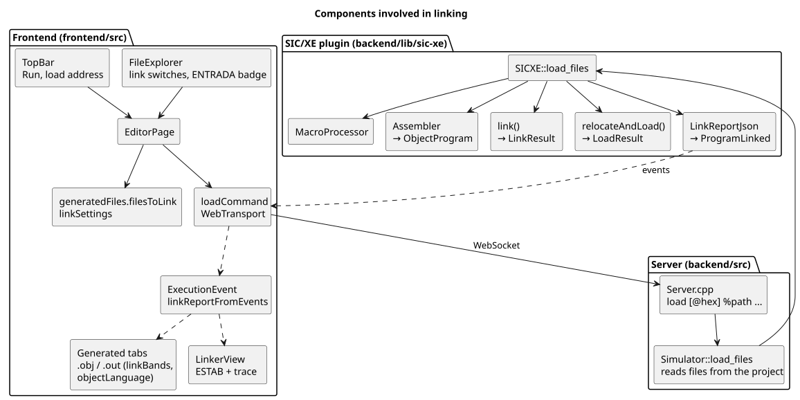
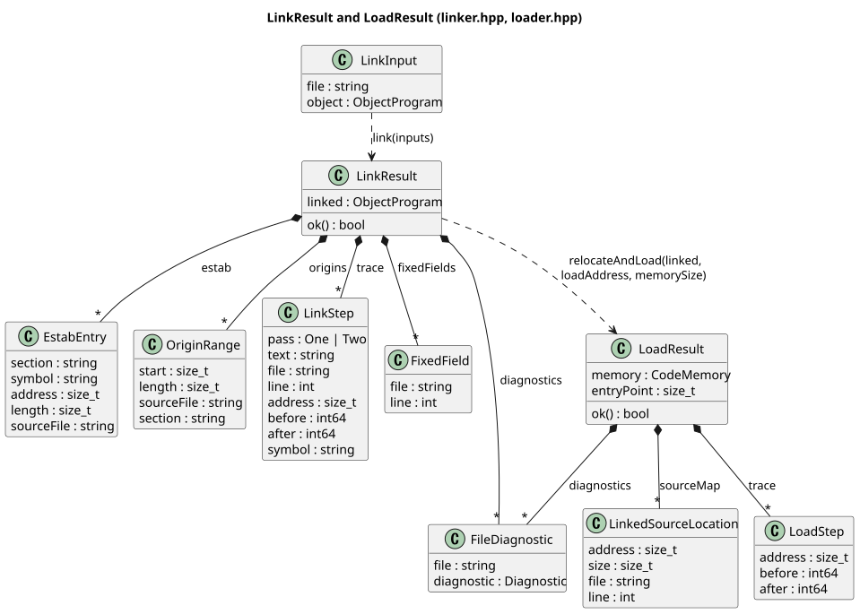
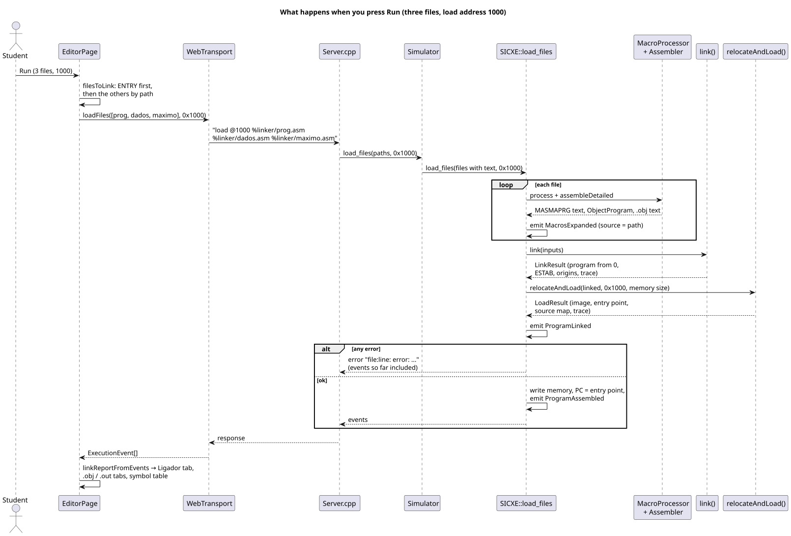

# 8. The codebase

Where each idea from chapters 3 to 7 lives, and how one click on Run reaches the linker and
comes back to the screen. Paths are from the repository root.

## The layers



[diagrams/08-components.puml](diagrams/08-components.puml)

| Layer | What it does for linking |
|---|---|
| Frontend (Next.js, `frontend/src`) | lets the student choose files and a load address, sends the `load` command, shows `.obj`, `.out`, the ESTAB and the trace |
| Server (`backend/src`) | parses `load [@hex] %path ...`, finds the files in the project, calls the architecture |
| SIC/XE plugin (`backend/lib/sic-xe`) | macro processor, assembler, linker and loader, then writes memory and emits events |

The linker and the loader do not touch the CPU or the event system. They are plain functions
over plain data in the `sicxe_assembler` static library, which is why they are easy to test.

## Backend files

| File | Role | Chapter |
|---|---|---|
| `backend/lib/sic-xe/include/assembler/object_program.hpp` | `ObjectProgram`, `ControlSection`, `ModRecord`, `TextRun`: the object program as data | 5 |
| `backend/lib/sic-xe/src/Assembler/assembler.cpp` | `CSECT`/`EXTDEF`/`EXTREF`/`ENTRY`, M records, fixed-field warnings | 3, 4 |
| `backend/lib/sic-xe/include/assembler/object_text.hpp`, `src/Assembler/object_text.cpp` | `renderObjectText`: the readable `.obj`/`.out`, and the colour bands of `.out` | 5 |
| `backend/lib/sic-xe/include/assembler/linker.hpp`, `src/Assembler/linker.cpp` | `link(inputs) → LinkResult`: checks, pass 1, pass 2, net relocation | 6 |
| `backend/lib/sic-xe/include/assembler/loader.hpp`, `src/Assembler/loader.cpp` | `relocateAndLoad(linked, loadAddress, memorySize) → LoadResult` | 7 |
| `backend/lib/sic-xe/src/LinkReportJson.cpp` | turns `LinkResult` + `LoadResult` into the JSON of the `ProgramLinked` event | 8 |
| `backend/lib/sic-xe/src/SICXE.cpp` | `SICXE::load_files`: runs the whole pipeline and writes memory | 8 |
| `backend/include/architecture/IArchictecture.hpp` | the `load_files(files, loadAddress)` entry every architecture plugin implements | 8 |
| `backend/src/Simulator.cpp` | `Simulator::load_files`: reads each path from the current project, rejects duplicates | 8 |
| `backend/src/Server.cpp` | the WebSocket command `load [@hex] %path [%path ...]` | 8 |
| `backend/include/architecture/events/ProgramLinked.hpp` | the event the frontend reads | 8 |

The data the linker and loader return:



[diagrams/08-link-model.puml](diagrams/08-link-model.puml)

## Frontend files

| File | Role |
|---|---|
| `frontend/src/lib/simulator/defaultLinkerSources.ts` | the linker tour every new project starts with |
| `frontend/src/lib/simulator/linkSettings.ts` | the chosen files and load address, kept in `localStorage` under `sicxe.link.<projectId>` |
| `frontend/src/lib/simulator/generatedFiles.ts` | `canLink`, `isEntryFile`, `filesToLink` (the `ENTRY` file first, then the others by path) |
| `frontend/src/lib/transport/loadCommand.ts` | builds `load @1000 %a %b`; address 0 is left out |
| `frontend/src/lib/transport/WebTransport.tsx` | sends the command and returns the events |
| `frontend/src/lib/simulator/ExecutionEvent.ts` | `LinkReport`, `EstabRow`, `LinkerTraceStep` and `linkReportFromEvents`, which validates the `ProgramLinked` JSON |
| `frontend/src/lib/simulator/generatedOutputs.ts` | the tabs beside the editor: `MASMAPRG.ASM`, `<file>.obj`, `<PROG>.out` |
| `frontend/src/lib/simulator/linkBands.ts` | one coloured band per section in `.out`, its hover text, and `sectionStartLine` for click-to-open |
| `frontend/src/lib/language/objectLanguage.ts` | syntax highlighting for `.obj` and `.out` |
| `frontend/src/components/FileExplorer.tsx` | the link switch on each file and the `ENTRADA` badge |
| `frontend/src/components/TopBar.tsx` | Run (with the file count) and the load address field |
| `frontend/src/components/LinkerView.tsx` | the Ligador tab: Tabelas (ESTAB) and Rastreio (trace) |
| `frontend/src/components/SymbolTable.tsx` | labels grouped by section and file |
| `frontend/src/components/EditorPage.tsx` | ties it together: Run, the tabs, following a step into another file |

## One Run, end to end



[diagrams/08-run-sequence.puml](diagrams/08-run-sequence.puml)

1. `EditorPage` asks `filesToLink` for the switched-on files, `ENTRY` first. With one file
   and address 0 it sends the old `load %file`; otherwise `loadCommand` builds
   `load @1000 %linker/prog.asm %linker/dados.asm %linker/maximo.asm`.
2. `Server.cpp` matches `^load (?:@([0-9a-fA-F]+) )?%(.+)$`, splits the paths on `" %"` and
   calls `Simulator::load_files`, which reads each file from the current project.
3. `SICXE::load_files`, for each file: the macro processor (emits `MacrosExpanded` with the
   file's path in `source`), then the assembler, giving an `ObjectProgram` and its `.obj`
   text.
4. `link(inputs)`, then `relocateAndLoad(...)` if the link succeeded.
5. `ProgramLinked` is emitted **before** errors are checked, so the editor shows the ESTAB,
   the `.obj` files and whatever was linked even when something failed.
6. Errors from the linker or loader are mapped back to source lines (through `MASMAPRG.ASM`
   when a file has macros) and returned as one message per problem, `file:line: error: …`.
7. On success: memory is written, `PC` set to the entry point, the source map stored for the
   debugger, and `ProgramAssembled` emitted with every label already at its loaded address.
8. The frontend reads the events: `linkReportFromEvents` for the Ligador tab and the
   generated tabs, the macro reports per file, the symbol table.

A single file at address 0 goes through the same `load_files` path: `load_file(content)` is
`load_files({{"", content}}, 0)`.

## The `ProgramLinked` event

```json
{
  "type": "ProgramLinked",
  "details": {
    "loadAddress": 4096,
    "estab": [{ "section": "PROG", "symbol": "", "address": 0, "length": 35, "file": "linker/prog.asm" }],
    "objects": [{ "source": "linker/prog.asm", "text": "H PROG   000000 000023\n..." }],
    "out": { "name": "PROG", "text": "H PROG   000000 000045\n...",
             "bands": [{ "firstLine": 2, "lastLine": 13, "label": "linker/prog.asm · PROG" }] },
    "trace": [{ "pass": "1", "text": "PROG placed at 000000", "file": "linker/prog.asm",
                "line": 28, "address": 0, "before": 0, "after": 0, "symbol": "PROG" }]
  }
}
```

Numbers are decimal in JSON (`4096` is `1000` hex). `trace[].pass` is `"1"`, `"2"` or
`"load"`. The full protocol is in
[backend/docs/websocket-protocol.md](../../backend/docs/websocket-protocol.md).

## Tests

| Where | What | Run with |
|---|---|---|
| `backend/lib/sic-xe/test/test_linker.cpp` | 23 tests of the linker and loader: Beck Fig. 3.8 → 3.9 records, Fig. 3.10(a) memory at 4000, every error | `ctest` in `backend/build` |
| `backend/lib/sic-xe/test/test_assembler.cpp` | control sections, M records, Fig. 2.15 → 2.17 | `ctest` |
| `backend/lib/sic-xe/test/data/` | Beck's figures as golden files | |
| `backend/tests/api/test/suites/ws-linker.js` | the `load @… %…` command over a real WebSocket | `npm test` in `backend/tests/api` |
| `backend/tests/api/test/suites/default-sources.js` | links the tour at `1000` and steps to `HALT`, checking the memory values of chapter 7 | `npm test` |
| `frontend/src/**/*.test.ts(x)` | `linkBands`, `linkSettings`, `generatedOutputs`, `LinkerView`, `EditorPage.linker`, … | `npx vitest run` in `frontend` |

## Where to start for common changes

| You want to… | Start in |
|---|---|
| change a record or the `.obj` layout | `object_program.hpp`, then `object_text.cpp` and its tests in `test_linker.cpp` |
| add a linker check or error | `linker.cpp`, with a test in `test_linker.cpp`; the message reaches the UI unchanged |
| change what the loader refuses | `loader.cpp` and `test_linker.cpp` |
| show something new from the link in the UI | add it in `LinkReportJson.cpp`, parse it in `ExecutionEvent.ts` (`linkReportFromEvents`), display it in `LinkerView.tsx` |
| change how files are chosen or ordered | `generatedFiles.ts` (`filesToLink`) and `linkSettings.ts` |

Next: [9. Hands-on](09-hands-on.md).
