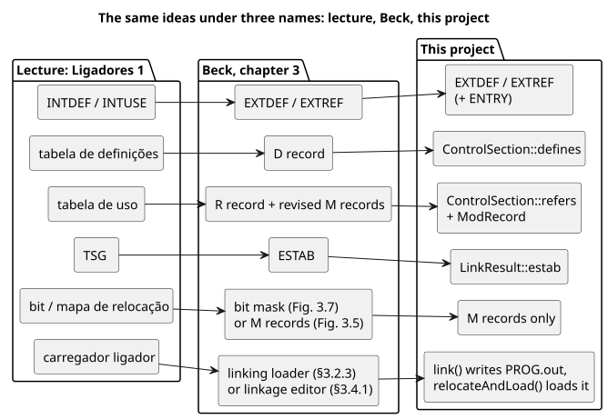

# 10. From the lecture to the code

Chapters 1 to 9 follow Beck. The course lecture, *Programação de Sistemas: ligadores
(linkers) 1* ([resources/parsed/04-projetos-de-computadores-1-ligadores-1.md](../../resources/parsed/04-projetos-de-computadores-1-ligadores-1.md)),
teaches the same ideas with different names and an older, simpler machine model. The
professor will use the lecture's words, so this chapter translates them. Slide 3 of the
presentation, *Da aula ao código*, is a one-page version of this chapter.

[diagrams/10-vocabulary-map.puml](diagrams/10-vocabulary-map.puml)

## The task statement: two variants

The stage 4 statement ([resources/parsed/eaula.md](../../resources/parsed/eaula.md), *Quarta
etapa*) asks for a two-pass linker and allows two variants:

| Variant | Who finishes relocation | Loader it relies on |
|---|---|---|
| *ligador-relocador* (linker and relocator) | the linker, because the load address is known in advance | an absolute loader |
| *apenas um ligador* (only a linker) | the loader, at load time | a relocating loader |

This project built the second one. `PROG.out` still counts from 0, its fields that hold an
address carry `M +PROG`, and the loader adds the load address (chapters 6 and 7).

The first variant would be a small change: start CSADDR at the load address instead of 0,
and drop the `M +PROG` records from the output because nothing is left to relocate. The
editor already knows the load address before it links, so either would work here. The
second variant was chosen because `PROG.out` then stays valid for any load address and
the linker can be tested without knowing where the program will run.

## The lecture's vocabulary

| Lecture (Portuguese) | Meaning | Beck | This project |
|---|---|---|---|
| *segmento* | a piece of program translated alone | control section | a control section (`START`, `ENTRY` or `CSECT`) |
| *identificação explícita* | symbols shared between segments are declared | `EXTDEF`, `EXTREF` | the same; a name used but not declared is an assembler error (`Undefined symbol`) |
| *identificação implícita* | any undefined symbol is assumed external | — | not supported |
| `INTDEF` | "defined here, usable elsewhere" | `EXTDEF` | `EXTDEF` |
| `INTUSE` | "used here, defined elsewhere" | `EXTREF` | `EXTREF` |
| *tabela de definições* | per segment: symbol, address, relocation mode | D record (plus the section name in H) | `ControlSection::defines`, written as the D record |
| *tabela de uso* | per segment: symbol, address of the field, mode, sign | R record plus revised M records | `ControlSection::refers` and `ModRecord` (address, length, sign, symbol) |
| *tabela de símbolos globais* (TSG) | union of all definition tables, addresses adjusted | ESTAB | `LinkResult::estab` |
| *modo de relocabilidade* (r / a) | relative (moves with the program) or absolute | relative or absolute expression (§2.3.3) | absolute or relative per symbol in the ESTAB; net relocation 0 or 1 per field |
| *constante de relocação* | the number added to relocated fields | CSADDR, PROGADDR | CSADDR in the linker, the load address in the loader |
| *bit de relocação*, *mapa de relocação* | marks of which words to relocate | relocation bit mask (Fig. 3.7) | not used: M records only |
| *carregador absoluto* | loads at a fixed address | absolute loader (§3.1.1) | a program whose `START` is not 0 |
| *carregador relocador* | adds a relocation constant while loading | relocating loader (§3.2.1) | `relocateAndLoad` |
| *carregador ligador* | links, relocates and loads in one program | linking loader (§3.2.3) | not used: linking and loading are separate |
| *vetor de transferência* | a table of jumps to external subroutines | — | not used |
| *overlay* | segments that share memory at different times | — | not implemented |
| *carga dinâmica*, *ligação dinâmica* | loading or linking during execution | dynamic linking (§3.4.2) | not implemented |

The rest of the chapter explains the rows that the earlier chapters do not cover.

## Definition table, usage table and TSG: the lecture's example

The lecture links two segments. Segment 1 (`PROG1`, 31 bytes long in the lecture's decimal
addresses) uses `PROG2` and `TABLE` from segment 2, and exports `TEST`, `RESUMEPT` and
`HEAD`.

The assembler builds two tables per segment:

- the **definition table** lists what the segment exports: `PROG1 00 r`, `TEST 10 r`,
  `RESUMEPT 12 r`, `HEAD 22 r`;
- the **usage table** lists every field that uses an imported name: `PROG2` at 11 with
  sign `+`, `TABLE` at 21 with sign `+`.

Pass 1 copies segment 1's definition table into the TSG unchanged, then copies segment 2's
with 31 (the length of segment 1) added to every address. `PROG2` goes from 00 to 31 and
`TABLE` from 27 to 58.

Pass 2 walks each usage table. The field at 11 held 00, and `PROG2` is 31 in the TSG, so it
becomes 31. The field at 21 came from `LOAD TABLE+2` and held 02; `TABLE` is 58, so it becomes
60. Both fields are now marked `r`: they hold addresses that the loader will still move.

In this project the same steps read:

| Lecture | Here |
|---|---|
| definition table of a segment | the D record of a section, plus the section name |
| usage-table entry `TABLE 21 +` | an M record at that field's address with sign `+` and symbol `TABLE` |
| pass 1: copy and add the segment length | pass 1: ESTAB ← name, CSADDR + address; CSADDR += length |
| pass 2: add the TSG value to each used field | pass 2: add or subtract the ESTAB value as each M record says |
| the result is marked `r` | net relocation 1, so `PROG.out` gets `M +PROG` |

The lecture also assumes the segments are loaded one after the other, so that one relocation
constant per segment is enough, and notes that this restriction can be removed. This project
keeps the restriction: sections are placed in order, each at the end of the previous one.

## Relocation mode and net relocation

The lecture tags every symbol and every word with a mode: `r` (relative, must move with the
program) or `a` (absolute, must not). A field that holds `TABLE+2` is relative; one that holds
a count, an opcode or an immediate value is absolute.

Beck's word for the same idea is relative and absolute expressions (§2.3.3). This project
computes it per field as **net relocation** (chapter 6): +1 for each relative name added,
−1 for each one subtracted.

| Net | Lecture's mode | Example | What happens |
|---|---|---|---|
| 0 | `a` | `WORD MAIOR-N`, a distance | nothing; the field is right at any address |
| 1 | `r` | `WORD MAIOR`, `+LDA N` | `M +PROG` in `PROG.out`; the loader adds the load address |
| other | no mode | `WORD MAIOR+N` | error: `relocation of this field is not 0 or 1 (net 2)` |

## Relocation bits and relocation maps

The lecture gives three ways to tell a relocating loader which words to move:

1. **Relocation bit, word by word** (*bit a bit*). Each group of text bytes carries one bit
   per byte, written next to the code. In the lecture's example, `00 3 011 13 33 35` means
   "at address 00, three bytes, bits 0 1 1". With relocation constant 40, the first byte (the
   opcode 13) stays, the other two are relocated: `13 73 75`.
2. **Whole relocation map** (*mapa inteiro*). All the bits go in one area after the code.
3. **Relocation map in blocks** (*mapa em blocos*). One map per block of code.

Beck shows the bit version for SIC in Fig. 3.7: each T record carries a 12-bit mask, one bit
per 3-byte word. It suits SIC, where almost every instruction holds a direct address. It does
not suit SIC/XE, where most instructions are PC-relative and do not move, and where format 4
holds a 20-bit address that does not start at a byte boundary.

This project uses only M records (Beck §3.2.1). An M record names the exact address and the
number of half-bytes to change, so it can mark the 5 half-bytes of a format 4 address.

The cost: a **SIC** instruction has a 15-bit direct address and no M record can be generated
for it. A SIC program, or a SIC/XE program with such a field, cannot move. Chapter 3 calls
these **fixed fields**. The simulator accepts them in the section loaded at 0 and refuses
them anywhere else, with the line.

## Kinds of loader

The lecture orders loaders from simple to complete. Chapter 7 has the same comparison with
Beck's names.

- **Absolute loader** (*carregador absoluto*, Beck §3.1.1). It reads text that already holds
  final addresses and copies it to memory. It needs a translator that knew the load address.
  In this project, a single program with `START 1000` is absolute: it loads where it was
  assembled, and the load address must be left at 0.
- **Relocating loader** (*carregador relocador*, Beck §3.2.1). It adds a relocation constant
  to the marked fields. This project's loader is one; the marks are the `M +PROG` records.
- **Linking loader** (*carregador ligador*, Beck §3.2.3). One program that allocates,
  builds the TSG, relocates and loads, in two passes. The lecture notes the difference from a
  linker: it does not write the relocation information out with the code. This project
  splits that work in two. The linker is a **linkage editor** (Beck §3.4.1): it writes a
  linked program, `PROG.out`, that keeps its relocation marks. A small relocating loader
  finishes the job.

## Transfer vector

The lecture's *vetor de transferência* is an older way to call subroutines in other
segments. Data is kept in one global area, so only subroutine calls are external. The
assembler builds a vector with one jump per external subroutine name, and every call in the
code jumps to its vector entry. When the program is loaded, the loader loads each named
subroutine and replaces the name in its vector entry with the subroutine's real address.

The calling code never changes; only the vector does. That is why it was attractive when
loaders were simple. It costs one extra jump per call, and it does not handle external data.

This project does not use one. `+JSUB MAXIMO` is patched in place by an M record, and data
such as `K` is shared the same way.

## Overlays

An overlay structure lets a program larger than memory run anyway. The programmer describes
which segments can share the same memory at different times, usually as a tree: the root is
always in memory, and sibling branches are never needed together. When code calls into a
segment that is not in memory, an overlay manager loads it over the one that was there.

The lecture calls the tool that builds this a *static overlay generator*. Levine,
*Linkers and Loaders*, chapter 8.5, describes tree-structured overlays in detail
([resources/parsed](../../resources/parsed/)). This project does not implement overlays: the
SIC/XE memory is 1 MB (2²⁰ bytes) and the programs are small.

## Dynamic loading and dynamic linking

- **Dynamic loading** (*carga dinâmica*): the linker leaves calls that ask the loader for a
  segment during execution.
- **Dynamic linking** (*ligação dinâmica*, Beck §3.4.2): a routine is found, loaded and
  linked the first time it is called. Beck uses an operating-system service request that
  looks the name up and loads the routine. Today's shared libraries (`.dll`, `.so`) are the
  same idea.

Neither is implemented here. Every reference is resolved before the program starts.

## One difference from Beck: `ENTRY`

Beck finds the main program by the operand of its `END`, and loads sections in the order of
the loader command. This project adds the `ENTRY` directive instead (chapter 4):

| | Beck | This project |
|---|---|---|
| main program | the one whose `END` has an operand | the one with `ENTRY` |
| load order | as in the command | the `ENTRY` file first, then as in the command |
| start address | `END` operand | `END` operand of the `ENTRY` file |
| a single file | `START` | `START`, as in stage 3 |

The reason is the editor: linked files are switched on and off in a tree, which has no order,
and the linker needs to know which file goes at address 0 before pass 1. That matters for
fixed fields, which only work in the first section.

The cost has to be stated when asked. Beck's Fig. 3.8 only links here if `PROGA START 0` is
changed to `PROGA ENTRY 0`; the test fixture
[beck_fig3_8_proga.asm](../../backend/lib/sic-xe/test/data/beck_fig3_8_proga.asm) has that change. In Salomon's
*Assemblers and Loaders*, also in the course material, `ENTRY` means something else: it
declares exported symbols, the job `EXTDEF` does here.

## What to remember

- TSG = ESTAB; definition table = D record; usage table = R record plus M records.
- The lecture's mode `r`/`a` is net relocation 1/0 here; any other value is an error.
- Relocation bits suit SIC; M records suit SIC/XE. This project uses only M records, so
  SIC fields cannot move.
- The project is the *apenas um ligador* variant: linkage editor plus relocating loader.
- Transfer vectors, overlays and dynamic linking are known techniques that this project
  does not implement.
