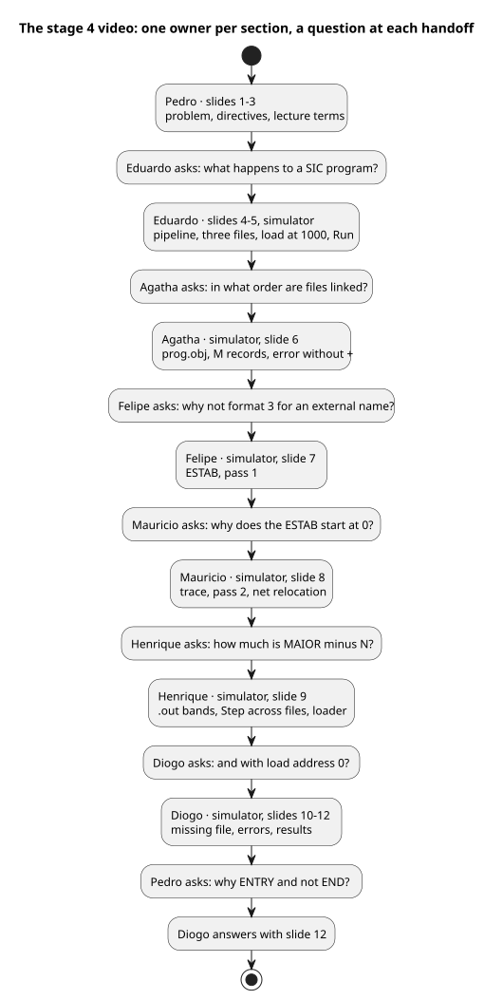

# 11. The presentation, slide by slide

This chapter goes with the stage 4 video:
[docs/apresentacao/etapa4-ligador.html](../apresentacao/etapa4-ligador.html) (the slides) and
[docs/apresentacao/etapa4-roteiro.md](../apresentacao/etapa4-roteiro.md) (what each person
says). The script is short on purpose. This chapter is the long version: for every slide, the
theory behind it, where it lives in the code, and the questions a presenter should be ready
for.

Read chapters 1 to 7 and [chapter 10](10-the-lecture.md) first, or at least the ones the
slide you present points to.



[diagrams/11-video-flow.puml](diagrams/11-video-flow.puml)

## Why the video looks like this

The stage 4 statement ([resources/parsed/eaula.md](../../resources/parsed/eaula.md)) asks for
a video of at most 10 minutes, with 5 of tolerance, by the whole group. It must show the
interaction between the members and an *arguição* (an argued explanation) of how the work
functions and which techniques it uses. It must not be only slides, nor a series of individual
presentations.

So each section has one owner who talks and drives the simulator, and the next owner asks
one question at the handoff. Most of the video is the simulator running; the slides explain
what just appeared on screen.

| Slide | Owner | Topic | Chapters |
|---|---|---|---|
| 1–3 | Pedro | the problem, the directives, the lecture's terms | 1, 4, 10 |
| 4–5 | Eduardo | the pipeline, the Run | 1, 8 |
| 6 | Agatha | the object program | 5 |
| 7 | Felipe | pass 1 and the ESTAB | 6 |
| 8 | Mauricio | pass 2 and net relocation | 3, 6 |
| 9 | Henrique | the loader, the editor, Step | 7, 8 |
| 10–12 | Diogo | errors, results, why `ENTRY` | 3, 9, 10 |

All the numbers on the slides come from linking the tour at load address `1000`. If you
change a tour file before recording, the numbers on the slides will no longer match.

---

## Slide 1 · Cover (Pedro)

**On the slide.** The title and, on the right, an excerpt of `PROG.out`: an H record for a
program of `0x45` bytes, one T record per section in its colour, labelled with its file and
section, an `M +PROG` and the E record.

**Background.** The colours are the same bands the editor draws on the `.out` tab. Each band
covers the T records of one control section, so the cover already shows the whole idea: four
pieces from three files, placed one after the other, in one program.

**If asked.**

- *Why is the program 0x45 bytes?* It is the sum of the section lengths: `23 + 6 + 6 + 16`
  (hex). Pass 1 computes it (chapter 6).

## Slide 2 · O problema e o programa (Pedro)

**On the slide.** What stage 4 adds, the three tour files, the table of directives and
lines 28 to 30 of `prog.asm`: `PROG ENTRY 0`, `EXTDEF N,M,MAIOR`, `EXTREF MAXIMO,K,TRIPLO`.

**Background.**

- Why split a program at all: separate assembly, reuse, teams (chapter 1).
- A **control section** has its own location counter starting at 0 and its own labels
  (chapter 4, Beck §2.3.5). `START` opens the first one in a file and `CSECT` opens another.
- A label is private to its section. To share it, the defining section lists it in
  `EXTDEF` and the using section lists it in `EXTREF`.
- `ENTRY` is this project's addition (chapter 4 and slide 12).

**In the code.** The directives are handled in
[assembler.cpp](../../backend/lib/sic-xe/src/Assembler/assembler.cpp). The tour's source is
[defaultLinkerSources.ts](../../frontend/src/lib/simulator/defaultLinkerSources.ts).

**If asked.**

- *What is the difference between `START` and `CSECT`?* Both open a section that counts from
  0. `START` must be the first statement of a file; `CSECT` opens a further section in the
  same file. `dados.asm` uses both: `DADOS START 0` and `TABELA CSECT`.
- *Can `TABELA` use `K`? They are in the same file.* Not directly. `K` belongs to `DADOS`.
  `TABELA` would need `EXTREF K`, just as if `K` were in another file.
- *Why is `MAXIMO` in `EXTREF` and not `EXTDEF`?* `prog.asm` uses it; `maximo.asm` defines it.

## Slide 3 · Da aula ao código (Pedro)

**On the slide.** The lecture's terms on the left, what they became in the simulator on the
right, and the kinds of loader with the variant we chose.

**Background.** This is [chapter 10](10-the-lecture.md) in one page. The key pairs: TSG =
ESTAB; definition table = D record; usage table = R record plus revised M records; mode
`r`/`a` = net relocation 1/0; relocation constant = CSADDR in the linker and the load address
in the loader.

**Handoff question (Eduardo): what happens to a SIC program, if there are no relocation
bits?** It cannot move. A SIC instruction holds a 15-bit direct address, and no M record can
describe a 15-bit field that shares its bytes with the opcode and the `x` bit. Beck relocates
SIC with a bit mask (Fig. 3.7); this project only has M records. So a SIC instruction, or a
format 3 instruction with a direct address of a relocatable label, is a **fixed field**: it
works where it was assembled, in the section loaded at 0, and is refused anywhere else
(slide 10).

**If asked.**

- *Why not implement relocation bits too?* They mark whole words. On SIC/XE most
  instructions are PC-relative and must not move, and a format 4 address is 20 bits inside a
  32-bit word. An M record says the exact address and number of half-bytes, which fits
  both cases.
- *Which variant of the task did you do?* The one with only a linker. The linker produces a
  program relative to 0 and the relocating loader finishes relocation at load time.

## Slide 4 · O pipeline (Eduardo)

**On the slide.** Files → macro processor → assembler → linker → `PROG.out` → loader, and the
WebSocket command of the Run button:
`load @1000 %linker/prog.asm %linker/dados.asm %linker/maximo.asm`.

**Background.**

- Each file is macro-expanded and assembled alone, exactly as in stage 3. That is what
  "separate assembly" means: the assembler never sees the other files, which is why it cannot
  know the address of `MAXIMO`.
- The linker is a **linkage editor** (Beck §3.4.1): it writes a linked program that still
  starts at 0. Beck's other design, the **linking loader** (§3.2.3), would link straight
  into memory at the load address (chapter 7).
- `@1000` is the load address in hex; without it, 0. Each `%` is a path in the project.

**In the code.** [Server.cpp](../../backend/src/Server.cpp) parses the command;
`Simulator::load_files` reads each file;
[SICXE.cpp](../../backend/lib/sic-xe/src/SICXE.cpp) `load_files` runs the pipeline. Chapter 8
traces a whole Run.

**If asked.**

- *Does a single file still work like stage 3?* Yes. `load_file` calls `load_files` with one
  file and address 0. There is only one path through the code.
- *What does the frontend get back?* A `MacrosExpanded` event per file and one
  `ProgramLinked` event with the ESTAB, every `.obj`, the `.out`, the colour bands and the
  trace. `ProgramLinked` is sent before the error check, so the screen shows what was linked
  even when something failed.

## Slide 5 · Demonstração (Eduardo, then everyone)

**On the slide.** Who drives the simulator in each part and what appears.

**What Eduardo shows.** The explorer with three files switched on, the ENTRADA badge on
`prog.asm`, the load address `1000` next to Run, the button reading three files, and after
Run the three new tabs: `MASMAPRG.ASM`, the `.obj` of the open file and `PROG.out`.

**Background.** The switches are the set of files to link. The editor orders them before
sending the command: the `ENTRY` file first, the others by path
([generatedFiles.ts](../../frontend/src/lib/simulator/generatedFiles.ts), `filesToLink`).

**Handoff question (Agatha): in what order does the linker receive the files?** The `ENTRY`
file first, because it must be at address 0 of the linked program: that is where the program
starts, and the only place a fixed field works. The others follow in the order of the
command.

**Before recording.** Backend and frontend running, the three switches on, load address 0.
If the simulator fails in the middle of a section, record that section again from the
previous handoff question.

## Slide 6 · O programa objeto de um arquivo (Agatha)

**On the slide.** `prog.obj`, with `M 00000A 05 +MAXIMO` and `M 00000E 05 +PROG`
highlighted.

```
H PROG   000000 000023
D N      00001A M      00001D MAIOR  000020
R MAXIMO K TRIPLO
T 000000 1D 032017 1B2014 0F2011 4B100000 0310001A ...
M 00000A 05 +MAXIMO
M 00000E 05 +PROG
M 000012 05 +K
M 000016 05 +TRIPLO
E 000000
```

**Background.** Chapter 5 reads every record. The points to make:

- H: name, start and length (`0x23` bytes). D: what the section exports, with addresses
  inside it. R: what it imports.
- `+JSUB MAXIMO` at `000009` is `4B100000`: format 4 with address 0, because the assembler
  does not know where `MAXIMO` will be. `M 00000A 05 +MAXIMO` asks the linker to add the
  address of `MAXIMO` to the 5 half-bytes (20 bits) that start at `00000A`, the address
  field of that instruction.
- `+LDA N` already holds `00001A`, the address of `N` within `PROG`. `M +PROG` says: this
  value is relative to the start of `PROG`, add wherever `PROG` ends up. This is a local
  relocation, written as Beck's revised M record (§2.3.5), where the sign and symbol replace the old
  "add the load address" meaning.
- E: the first instruction. Only the `ENTRY` file has one.

The readable `.obj` adds lines starting with a dot, which say which instruction made each
group of bytes. They are comments for people; the linker never reads the text back. It works
on the `ObjectProgram` structure the assembler returns
([object_program.hpp](../../backend/lib/sic-xe/include/assembler/object_program.hpp)).

**Live error.** Without the `+` in line 43 the assembler stops with
`linker/prog.asm:43:14: error: MAXIMO is an external reference; use +JSUB MAXIMO (format 4)`.

**Handoff question (Felipe): why does format 3 not work for an external name?** In format 3
the field is a 12-bit displacement from the PC (or from B). A displacement needs both
addresses, and the assembler does not know where the other file will be. Format 4 holds the
whole 20-bit address, which an M record can patch.

**If asked.**

- *Why 05 and not 06?* The address field of format 4 is 20 bits, 5 half-bytes, starting
  one half-byte into the second byte. A `WORD` gets `06`, all 24 bits.
- *Is the `.obj` file what the linker links?* No. It is generated for display. The linker
  links the in-memory object programs, which also carry source lines for error messages.

## Slide 7 · Passagem 1: a ESTAB (Felipe)

**On the slide.** The pass 1 algorithm and the ESTAB of the tour.

| Section | Symbol | Address | Length | File |
|---|---|---|---|---|
| `PROG` | | `000000` | `000023` | `prog.asm` |
| | `N`, `M`, `MAIOR` | `00001A`, `00001D`, `000020` | | |
| `DADOS` | | `000023` | `000006` | `dados.asm` |
| | `K`, `TRIPLO` | `000023`, `000026` | | |
| `TABELA` | | `000029` | `000006` | `dados.asm` |
| `MAXIMO` | | `00002F` | `000016` | `maximo.asm` |

**Background.**

- Why two passes: to patch `+JSUB MAXIMO` the linker needs the address of `MAXIMO`, which
  depends on the length of every section placed before it. Pass 1 places everything; pass 2
  patches. It is the forward-reference problem of a two-pass assembler, one level up
  (chapter 6).
- The algorithm: CSADDR starts at 0; for each section, the section name goes in the ESTAB
  at CSADDR, each D symbol goes in at CSADDR plus its address, and CSADDR grows by the
  section length. The lecture says the same: the first definition table is copied
  unchanged, the next ones with the earlier lengths added (chapter 10).
- The section name enters the ESTAB without any `EXTDEF`. That is what lets `M +PROG`,
  `M +DADOS` and so on be resolved like any other symbol.

**In the code.** `link()` in [linker.cpp](../../backend/lib/sic-xe/src/Assembler/linker.cpp),
the part after the comment `pass 1`. In the simulator: Ligador tab, Tabelas.

**Handoff question (Mauricio): the load address is 1000, so why does the ESTAB start at 0?**
Because the linker always works from 0. The load address is added by the loader at the end.
The same `PROG.out` then works at any load address.

**If asked.**

- *What if two sections export the same name?* Pass 1 reports `N is defined twice` in both
  files, each at the start line of the section that defines it.
- *What other errors does pass 1 find?* No `ENTRY` with two or more files, two `ENTRY`s, an
  `END` operand outside the `ENTRY` file, and a `START` other than 0 when files are linked.

## Slide 8 · Passagem 2: os registros M (Mauricio)

**On the slide.** The pass 2 trace (each M record, the field, before and after) and the
net-relocation table.

**Background.**

- Pass 2 copies each section's T bytes to CSADDR plus their address, then applies each M
  record: look up the symbol, add or subtract its address, keep the field's width.
- `+MAXIMO` at `00000A`: `000000 → 00002F`.
- The two orange rows are the same field, `WORD MAIOR-N` in `TABELA`, at `00002C`:
  `+MAIOR` gives `000020`, then `-N` gives `000006`.
- Then **net relocation** per field: +1 for each relative name added, −1 for each
  subtracted (chapter 3, chapter 6). 1 means the field is an address, so `PROG.out` gets
  `M +PROG` for it. 0 means a distance or a constant; nothing to do. Anything else is an
  error.

**In the code.** The second half of `link()` in
[linker.cpp](../../backend/lib/sic-xe/src/Assembler/linker.cpp). In the simulator: Ligador
tab, Rastreio; clicking a pass 2 step opens its source line and shows the `.obj` beside it.

**Handoff question (Henrique): how much is MAIOR minus N?** Net zero: one plus, one minus.
`6` bytes apart in any placement, so the loader leaves it alone.

**If asked.**

- *What would `WORD MAIOR+N` do?* Net 2. No load address makes that field right, so it is
  an error: `linker/dados.asm:17: error: relocation of this field is not 0 or 1 (net 2)`.
- *What if `MAXIMO` is not defined anywhere?* `undefined external symbol MAXIMO`, at the line
  of the field that uses it (slide 10).
- *How is this the lecture's usage table?* Each M record is one usage-table entry: field
  address, sign, symbol (chapter 10).

## Slide 9 · O carregador relocável (Henrique)

**On the slide.** One field from `.obj` to memory, and the loader trace of 9 fields.

| Stage | Bytes | Why |
|---|---|---|
| `prog.obj` | `4B100000` | assembled with 0 |
| after the linker, `+MAXIMO` | `4B10002F` | `MAXIMO` at `00002F` |
| after the loader, `+PROG` | `4B10102F` | plus `001000` |
| memory | `4B 10 10 2F` | at `001009` |

**What Henrique shows first.** The `.out` bands: hovering the green band shows
`linker/dados.asm · TABELA`, loaded at `001029–00102E` (6 bytes); clicking opens `dados.asm`
at `TABELA CSECT`. Then Step: at `+JSUB MAXIMO` the editor switches to `maximo.asm`, at
`RSUB` it returns to `prog.asm`.

**Background.**

- In `PROG.out` every M record is `+PROG`: external names are resolved, only the load
  address is left. The loader is Beck's relocating loader (§3.2.1): add the load address to
  each marked field and copy the bytes.
- `WORD MAIOR-N` at `00102C` is not in the trace: its net relocation is 0, so it has no M
  record in `PROG.out`.
- The loader also returns a source map, from memory address to file and line. That is how
  Step knows which file to open.
- It refuses an absolute program (`START` not 0) at a nonzero address, a program that does
  not fit in memory, and a fixed field at a nonzero address (chapter 7).

**In the code.** `relocateAndLoad` in
[loader.cpp](../../backend/lib/sic-xe/src/Assembler/loader.cpp). The bands and hover:
[linkBands.ts](../../frontend/src/lib/simulator/linkBands.ts).

**Handoff question (Diogo): and with load address 0?** Nothing moves. The loader trace is
empty and memory holds exactly the bytes of `PROG.out`.

**If asked.**

- *Why 9 fields?* `PROG.out` has 9 `M +PROG` records: the four format 4 instructions of
  `PROG`, `WORD MAIOR` in `TABELA`, and four format 4 instructions in `MAXIMO`.
- *Why does the instruction start at 001009 but the field at 00100A?* The M record points at
  the byte where the 20-bit address begins: the second byte of the instruction. The address
  starts in the low half of that byte, after the `x b p e` bits.

## Slide 10 · Erros e campos que não se movem (Diogo)

**On the slide.** Each error with its message, and the four kinds of fixed field.

**Live error.** With `maximo.asm` switched off:
`linker/prog.asm:43: error: undefined external symbol MAXIMO`.

**Background.**

- A **fixed field** is an address field no M record can correct (chapter 3): a SIC
  instruction; format 3 with a direct address of a relocatable label; PC-relative to an
  absolute target such as an `EQU`; base-relative where base and target differ in kind.
- PC-relative between labels of the same section is not fixed: both ends move together and
  the displacement stays right.
- A fixed field works in the first section loaded at 0. Elsewhere the linker or the loader
  refuses it with the line, instead of running with a wrong address. The assembler already
  warns with `consider +LDA`.

**If asked.**

- *Why refuse instead of warning?* A wrong address does not crash on load. It reads or jumps
  somewhere else later, which is much harder to trace back.
- *Where is each check?* Format and `EXTREF` checks in the assembler; `ENTRY`, duplicates,
  undefined names and net relocation in the linker; absolute programs, size and fixed fields
  in the loader. Chapter 9 breaks the tour on purpose to trigger most of them.

## Slide 11 · Execução e testes (Diogo)

**On the slide.** Memory at `HALT` with the program at `1000`, and the test counts.

| Address | Value | Name |
|---|---|---|
| `00101A` | `00000A` | `N = 10` |
| `00101D` | `000007` | `M = 7` |
| `001020` | `00000A` | `MAIOR = 10` |
| `001023` | `000003` | `K = 3` |
| `001026` | `00001E` | `TRIPLO = 30` |
| `001029` | `001020` | `ENDMAIOR`, the address of `MAIOR` |
| `00102C` | `000006` | `DISTANC = 6` |

**Background.** `ENDMAIOR` is the proof that relocation worked: it holds `001020`, where
`MAIOR` was loaded. `DISTANC` is the proof that net relocation 0 was left alone.

**Tests.** 23 linker and loader tests in C++ among the 135 of the backend, with Beck's
Fig. 2.15, 2.17, 3.8, 3.9 and 3.10a as data
([test_linker.cpp](../../backend/lib/sic-xe/test/test_linker.cpp)); 148 API tests, one of
which links the tour at `1000` and runs it to `HALT`; 276 frontend tests. Chapter 8 lists
how to run them.

## Slide 12 · Por que ENTRY (Diogo)

**On the slide.** Beck and this project side by side, and the reasons.

**Handoff question (Pedro): Beck finds the main program by the operand of `END`. Why
`ENTRY`?** The editor's files are switches with no order, and the linker must know which
file goes at 0 before pass 1, because of the transfer address and because fixed fields only
work there. The `END` operand still gives the start address, but only in the `ENTRY` file.

**Be honest about the cost** (chapter 10): Beck's Fig. 3.8 links here only with
`PROGA ENTRY 0` in place of `START`, and in Salomon's book `ENTRY` means an exported symbol.
A possible improvement is to also accept a main file with `START` whose `END` has an
operand, as Beck does.

## What to remember

- The video is the simulator first, slides second; each owner drives their part and answers
  one question.
- Every slide maps to a chapter. If you present slide N, read that chapter and the "If asked"
  list above.
- Never quote a number you have not seen on the slide or in the simulator. All of them come
  from the tour linked at `1000`.
